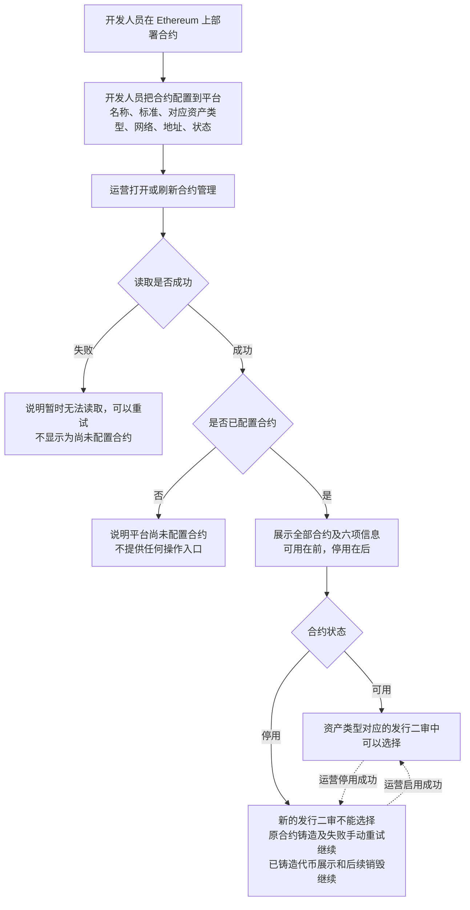
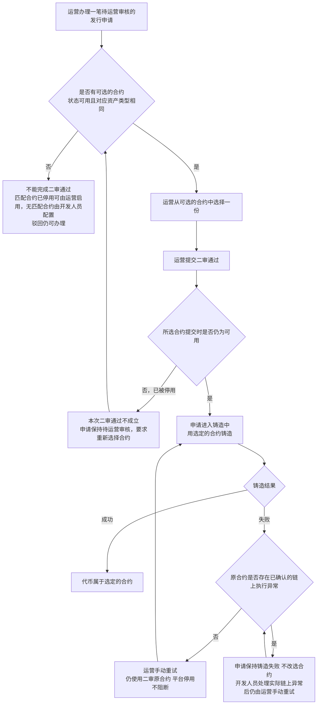
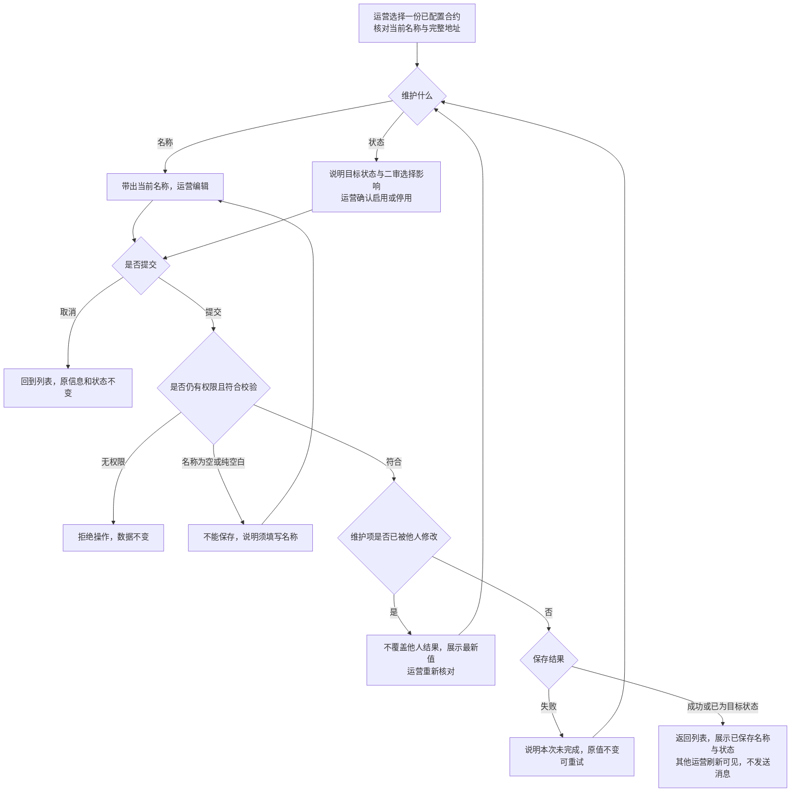
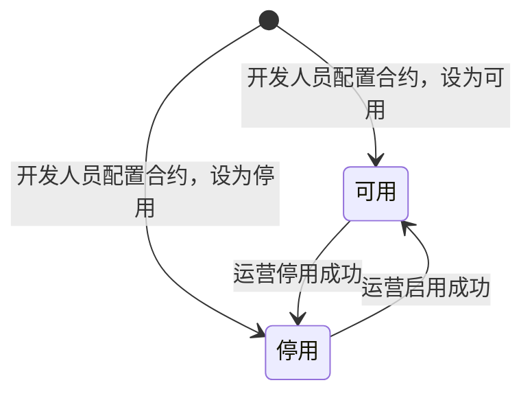

# 合约管理 · 流程图与状态机

2026-10-30｜需求评审稿

本册把[功能与业务规则](./v1.0-合约管理-PRD.md)中的主要流程与状态画成图，规则以功能册为准。图中方框是业务环节，不代表页面或组件。

| 图 | 内容 | 对应功能 |
| --- | --- | --- |
| [图 1](#fig-1) | 开发人员配置合约，运营在合约列表中查看，合约进入或离开发行二审的可选范围 | [合约列表（F-CT-01）](./v1.0-合约管理-PRD.md#F-CT-01) |
| [图 2](#fig-2) | 发行二审通过时选择合约，以及提交时合约已停用、没有可选合约的去向 | [发行二审可选的合约（F-CT-02）](./v1.0-合约管理-PRD.md#F-CT-02) |
| [图 3](#fig-3) | 运营编辑名称、启用与停用，以及取消、校验失败、保存失败与冲突的去向 | [编辑合约名称（F-CT-03）](./v1.0-合约管理-PRD.md#F-CT-03)、[启用与停用合约（F-CT-04）](./v1.0-合约管理-PRD.md#F-CT-04) |
| [合约状态机](#state-1) | 合约状态在可用与停用之间的变化 | [合约状态](./v1.0-合约管理-PRD.md#status) |

发行申请的状态（待运营审核、铸造中、铸造失败等）以简报第 5 节为准，由代币发行 · 审核与铸造（M3b）的图册画出，本册不重复。

## 合约从配置到被选用（图 1）

## 发行二审选择合约（图 2）

平台停用只限制首次选择；已确定合约的铸造、失败重试及代币销毁继续，规则见[停用与既有业务](./v1.0-合约管理-PRD.md#inflight)。

## 维护合约名称与状态（图 3）

名称长度与重名校验边界见[合约名称校验边界（Q-CT-02）](./v1.0-合约管理-PRD.md#Q-CT-02)。启用与停用不自动发起二审通过或铸造重试。

## 合约状态机

- 初始状态由开发人员配置时设定；运营可在两种状态间来回调整。
- 取消或保存失败时状态不变；并发冲突展示最新状态，不覆盖他人结果；已为目标状态时不再转换。
- 合约不从平台移除，没有终态；不再使用的合约保持停用。
- 状态变化不发送任何消息；停用阻止新的二审选择，既有业务、失败手动重试及已铸造代币销毁继续，见[停用与既有业务](./v1.0-合约管理-PRD.md#inflight)。
- 平台状态变化不自动发起业务或重试，不改变原合约及业务归属。
