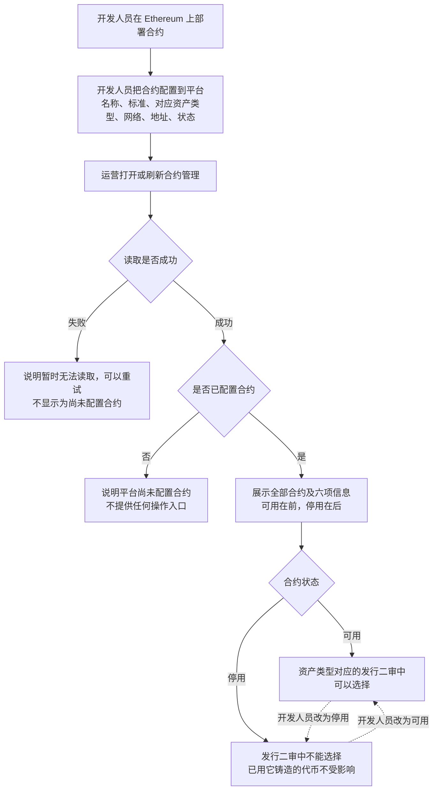
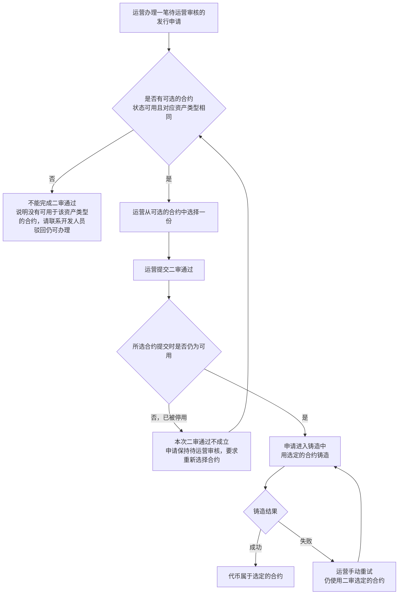
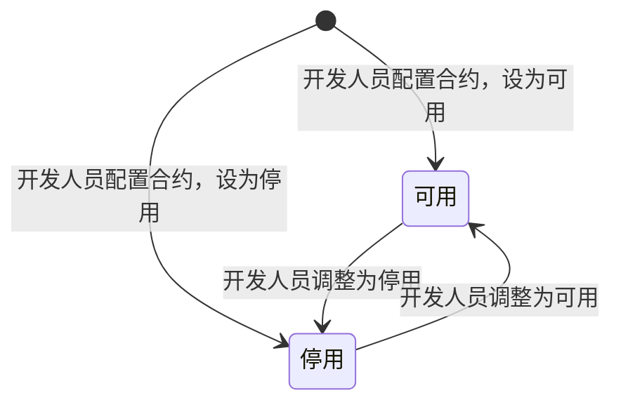

# 合约管理 · 流程图与状态机

2026-10-29｜需求评审稿

本册把[功能与业务规则](./v1.0-合约管理-PRD.md)中的主要流程与状态画成图，规则以功能册为准。图中方框是业务环节，不代表页面或组件。

| 图 | 内容 | 对应功能 |
| --- | --- | --- |
| [图 1](#fig-1) | 开发人员配置合约，运营在合约列表中查看，合约进入或离开发行二审的可选范围 | [合约列表（F-CT-01）](./v1.0-合约管理-PRD.md#F-CT-01) |
| [图 2](#fig-2) | 发行二审通过时选择合约，以及提交时合约已停用、没有可选合约的去向 | [发行二审可选的合约（F-CT-02）](./v1.0-合约管理-PRD.md#F-CT-02) |
| [合约状态机](#state-1) | 合约状态在可用与停用之间的变化 | [合约状态](./v1.0-合约管理-PRD.md#status) |

发行申请的状态（待运营审核、铸造中、铸造失败等）以简报第 5 节为准，由代币发行 · 审核与铸造（M3b）的图册画出，本册不重复。

## 合约从配置到被选用（图 1）

## 发行二审选择合约（图 2）

## 合约状态机

- 初始状态由开发人员配置时设定；运营不能改变合约状态。
- 合约不从平台移除，没有终态；不再使用的合约保持停用。
- 状态变化不发送任何消息；停用只影响之后的发行二审选择，对在途发行申请和已铸造代币的影响见[待确认（Q-CT-01）](./v1.0-合约管理-PRD.md#Q-CT-01)。
