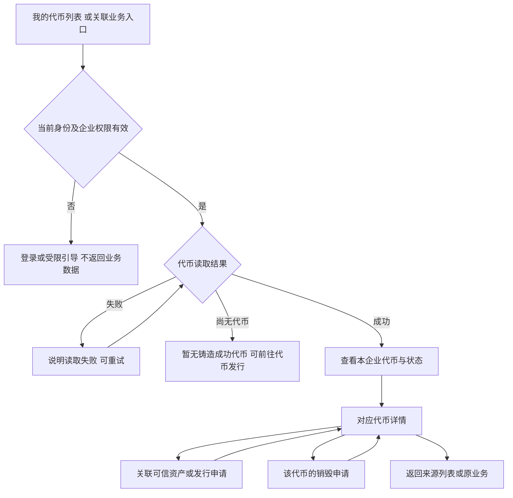
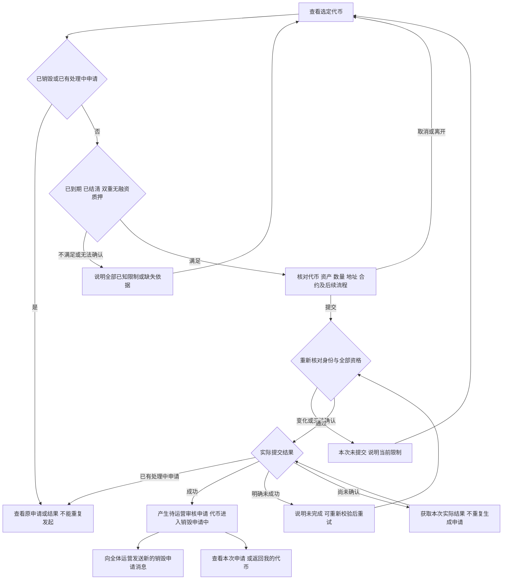
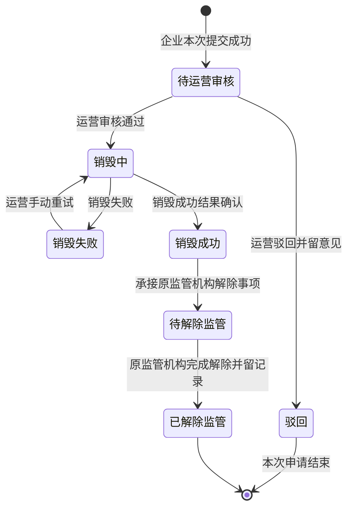
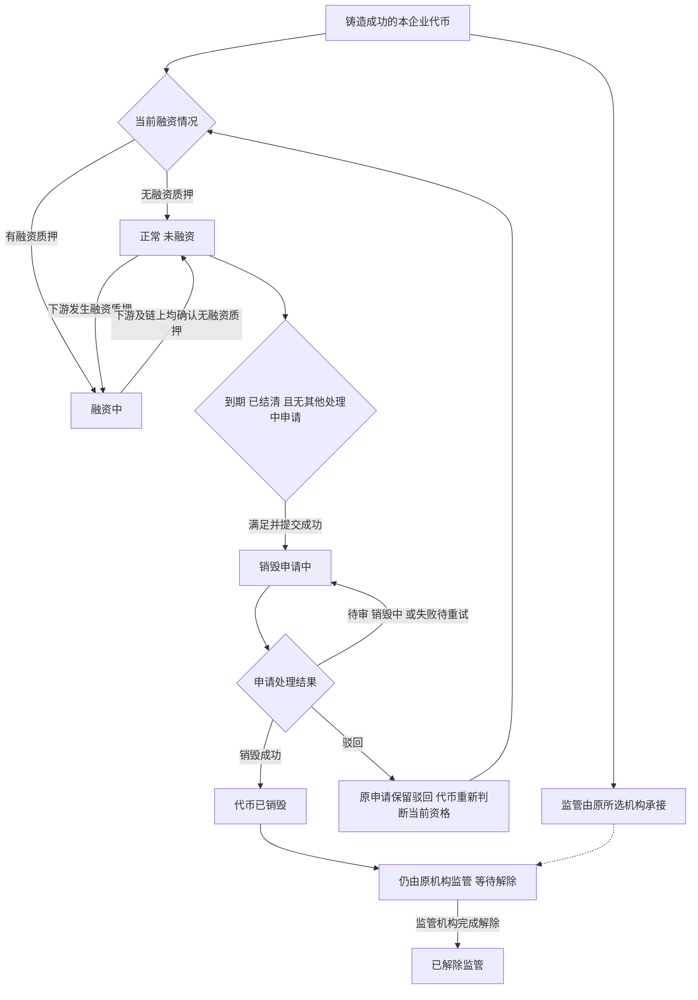

# 我的代币与销毁申请 · 流程图与状态机

2026-10-30｜面客端：企业用户｜需求评审稿

本册画出企业查看、发起、销毁与解除监管的业务过程，规则以[01 功能与业务规则](./v1.0-我的代币与销毁申请-PRD.md)为准。节点是业务环节，不代表页面或组件。状态引用简报第 5 节；监管相关名称按用户确认映射，不另建状态。跨端字段和可见范围直接引用 M4b [两端衔接字段清单](./v1.0-销毁审核与解除质押-PRD.md#handoff)。

| 图 | 内容 | 对应功能 |
| --- | --- | --- |
| 图 1 | 企业查看代币、关联业务与返回 | [我的代币列表（C-TOKEN-01）](./v1.0-我的代币与销毁申请-PRD.md#C-TOKEN-01)、[代币详情（C-TOKEN-02）](./v1.0-我的代币与销毁申请-PRD.md#C-TOKEN-02) |
| 图 2 | 销毁资格判断、确认与提交结果 | [销毁资格与限制原因（C-TOKEN-03）](./v1.0-我的代币与销毁申请-PRD.md#C-TOKEN-03)、[确认并提交（C-BURN-01）](./v1.0-我的代币与销毁申请-PRD.md#C-BURN-01) |
| 图 3 | 销毁申请状态及解除监管过程 | [申请详情与解除监管进度（C-BURN-03）](./v1.0-我的代币与销毁申请-PRD.md#C-BURN-03)、[驳回后再次发起（C-BURN-04）](./v1.0-我的代币与销毁申请-PRD.md#C-BURN-04) |
| 图 4 | 代币、融资与监管的独立关系 | [对象与状态](./v1.0-我的代币与销毁申请-PRD.md#states)、[多条件组合](./v1.0-我的代币与销毁申请-PRD.md#C-TOKEN-03) |

## 企业查看与返回（图 1）

关联对象无权或不存在时，统一说明暂不可访问；读取依赖信息失败不等于代币不存在。字段未知时保留可查内容，资格不放行。

## 校验与提交销毁申请（图 2）

融资两项结果均无质押才满足；任一有质押或两项不一致都不放行，任一未知也不放行。平台停用不阻断既有代币按原条件提交销毁或后续办理，仍使用原合约，见[停用与既有业务](./v1.0-合约管理-PRD.md#inflight)。

## 销毁申请状态与解除监管（图 3）

- 待解除监管、已解除监管分别对应简报的待解除资产质押、已解除质押；名称按用户后续确认映射。
- 销毁成功后即使当前进度已进入待解除监管，成功事实仍保留。
- 失败或未知结果不进入销毁成功；失败等待运营处理仍占用原申请，企业不能重新申请。
- 企业从驳回记录再次发起时，先重新校验并创建新申请，新申请从待运营审核开始；原申请仍为驳回。新旧记录用不同申请编号关联同一代币；驳回释放占用后按当前融资事实回退，未知时不放行，按 M4b [状态对应](./v1.0-销毁审核与解除质押-PRD.md#states)，不在同一状态机把驳回恢复成待审。
- 解除办理未成功或结果尚未确认时，不展示已解除监管，不替 M4b 增加失败终态或重试策略。

## 代币、融资与监管的关系（图 4）

融资与监管是独立信息；监管中不阻断满足条件的销毁，已销毁不等于监管已经解除。已销毁是代币终态，不能回到可申请。组合展示及未知信息以[功能册的资格组合](./v1.0-我的代币与销毁申请-PRD.md#C-TOKEN-03)为准。
