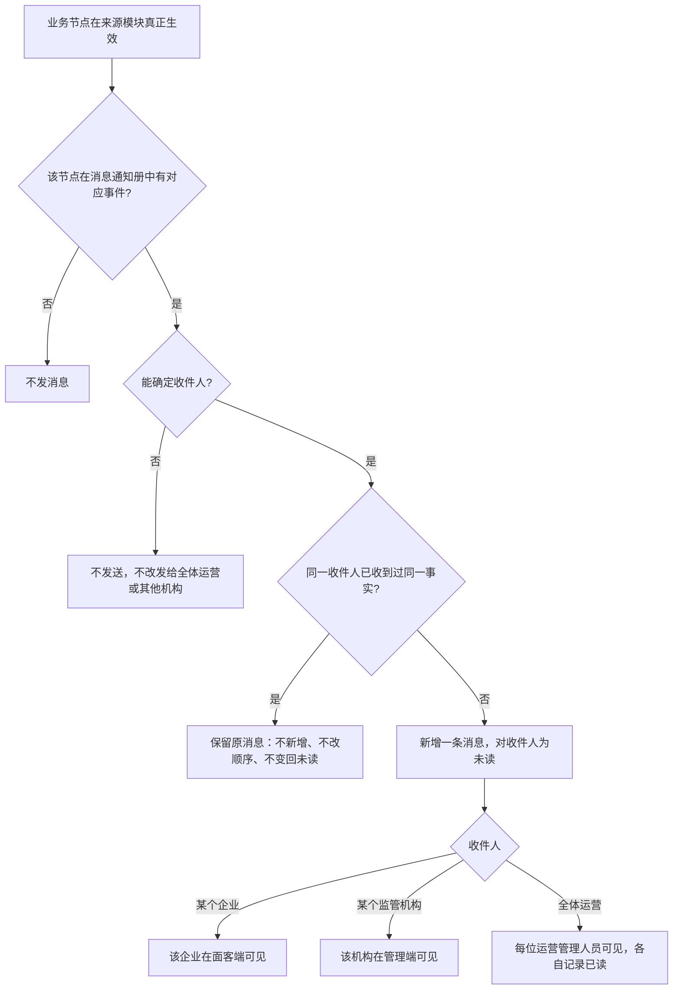
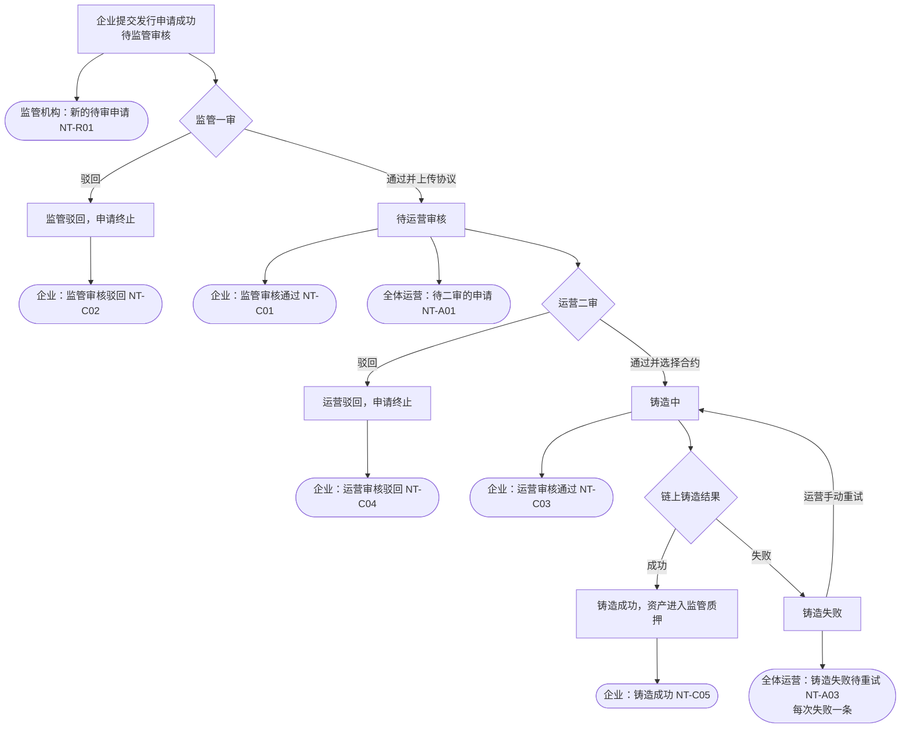
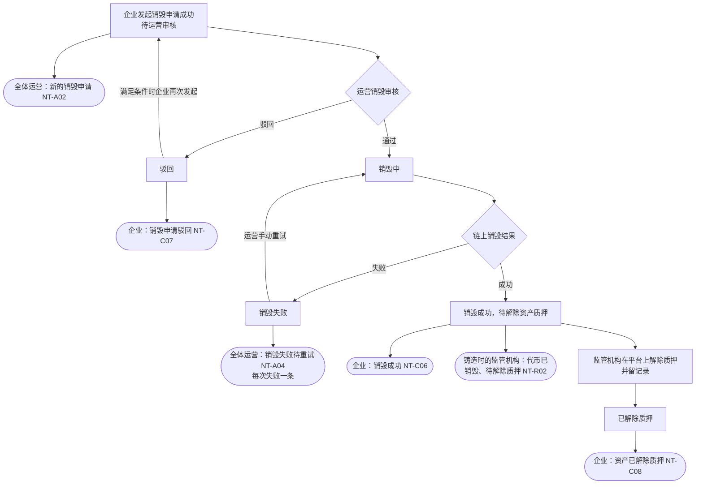
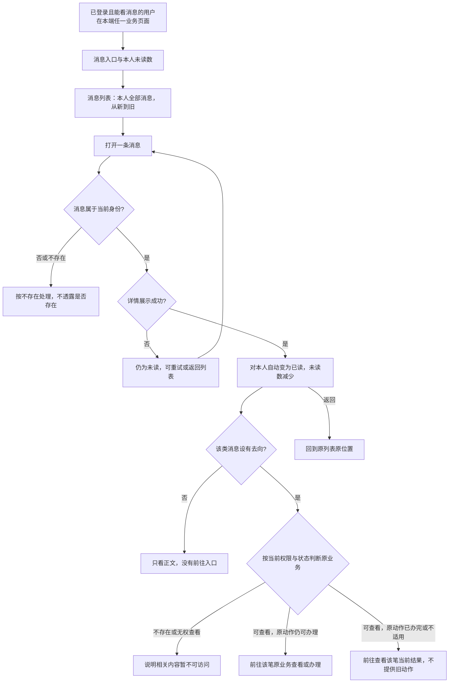
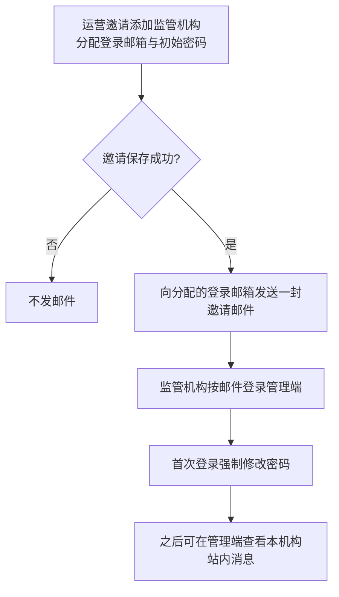
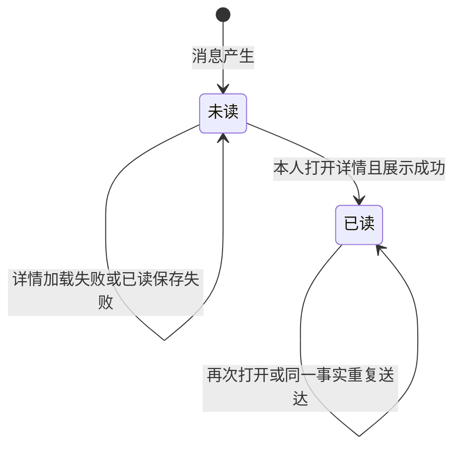

# 消息通知 · 流程图与状态机

2026-10-29｜需求评审稿

本册把[功能与业务规则](./v1.0-消息通知-PRD.md)和[消息通知](./v1.0-消息通知-消息通知.md)中的主要流程与状态画成图，规则以功能册和消息通知册为准。图中方框是业务环节，不代表页面或组件。发行申请与销毁申请的状态名称引用简报第 5 节。

| 图 | 内容 | 对应功能 |
| --- | --- | --- |
| [图 1](#fig-1) | 一条消息从业务节点生效到收件人看到 | [谁收到、谁能看到（MSG-01）](./v1.0-消息通知-PRD.md#MSG-01)、[消息的共同规则](./v1.0-消息通知-PRD.md#common) |
| [图 2](#fig-2) | 发行流程中各节点发出的消息 | [监管审核通过（NT-C01）](./v1.0-消息通知-消息通知.md#NT-C01)、[监管审核驳回（NT-C02）](./v1.0-消息通知-消息通知.md#NT-C02)、[运营审核通过（NT-C03）](./v1.0-消息通知-消息通知.md#NT-C03)、[运营审核驳回（NT-C04）](./v1.0-消息通知-消息通知.md#NT-C04)、[铸造成功（NT-C05）](./v1.0-消息通知-消息通知.md#NT-C05)、[新的待审申请（NT-R01）](./v1.0-消息通知-消息通知.md#NT-R01)、[待二审的申请（NT-A01）](./v1.0-消息通知-消息通知.md#NT-A01)、[铸造失败待重试（NT-A03）](./v1.0-消息通知-消息通知.md#NT-A03) |
| [图 3](#fig-3) | 销毁与解除质押流程中各节点发出的消息 | [销毁成功（NT-C06）](./v1.0-消息通知-消息通知.md#NT-C06)、[销毁申请驳回（NT-C07）](./v1.0-消息通知-消息通知.md#NT-C07)、[资产已解除质押（NT-C08）](./v1.0-消息通知-消息通知.md#NT-C08)、[代币已销毁、待解除质押（NT-R02）](./v1.0-消息通知-消息通知.md#NT-R02)、[新的销毁申请（NT-A02）](./v1.0-消息通知-消息通知.md#NT-A02)、[销毁失败待重试（NT-A04）](./v1.0-消息通知-消息通知.md#NT-A04) |
| [图 4](#fig-4) | 打开消息、自动已读与前往原业务 | [消息入口与未读数（MSG-02）](./v1.0-消息通知-PRD.md#MSG-02)、[消息详情与已读（MSG-04）](./v1.0-消息通知-PRD.md#MSG-04)、[前往原业务（MSG-05）](./v1.0-消息通知-PRD.md#MSG-05) |
| [图 5](#fig-5) | 监管机构邀请邮件 | [监管机构邀请邮件（NT-R03）](./v1.0-消息通知-消息通知.md#NT-R03) |
| [状态机 1](#state-1) | 一条站内消息对本人的阅读状态 | [消息详情与已读（MSG-04）](./v1.0-消息通知-PRD.md#MSG-04) |

## 一条消息从业务节点生效到收件人看到（图 1）

监管机构邀请邮件不走本图，见图 5。

## 发行流程中的消息（图 2）

运营重试铸造不再发送“运营审核通过”。企业不收铸造失败消息。

## 销毁与解除质押流程中的消息（图 3）

再次发起的销毁申请是新的一笔，再次发送“新的销毁申请”。

## 打开消息与前往原业务（图 4）

## 监管机构邀请邮件（图 5）

邮件是否包含初始密码、发送失败如何处理，见功能册[邀请邮件是否包含初始密码（Q-M7-02）](./v1.0-消息通知-PRD.md#Q-M7-02)与[邀请邮件发送失败与重置密码的告知（Q-M7-03）](./v1.0-消息通知-PRD.md#Q-M7-03)。

## 本人阅读状态（状态机 1）

- 已读是终态，本期没有“标为未读”。
- 状态属于“本人与这条消息”：全体运营消息对每位运营管理人员各有一份阅读状态。
- 运营账号开通前已存在的全体运营消息，对新账号直接为已读，不计入未读数。
