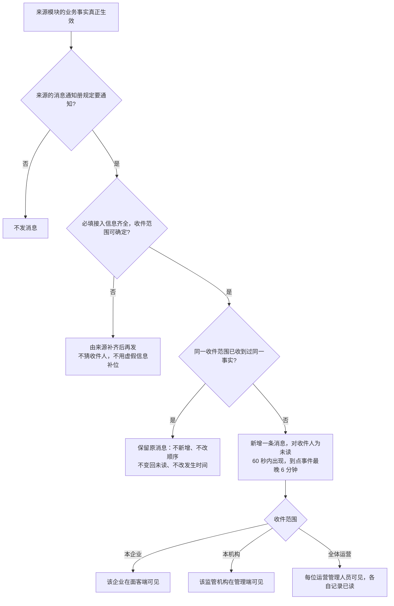
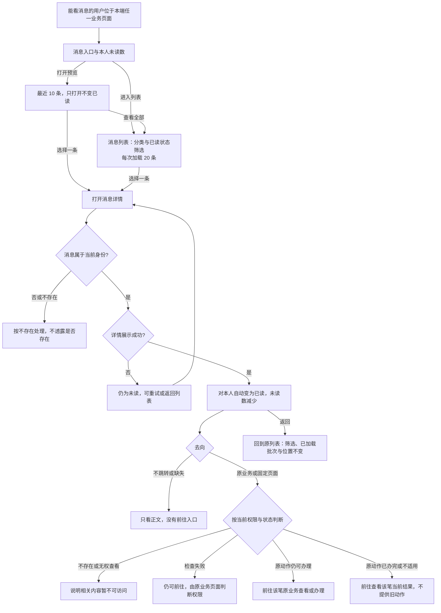
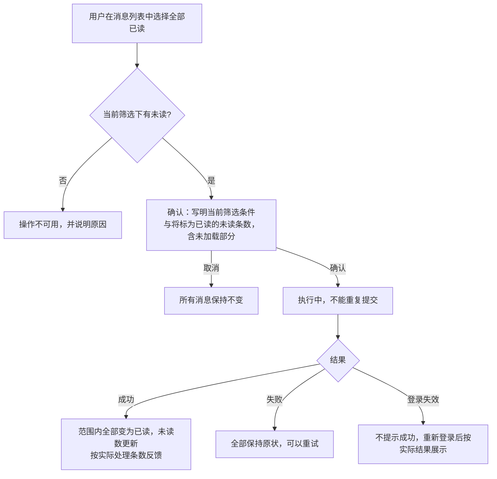
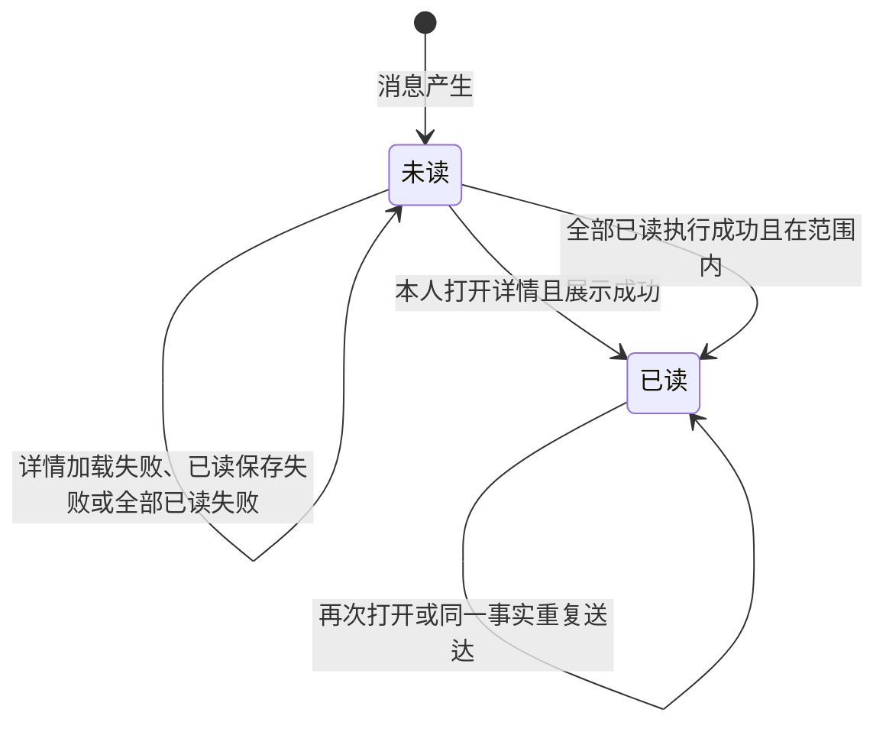

# 消息通知 · 流程图与状态机

2026-10-29｜需求评审稿

本册把[功能与业务规则](./v1.0-消息通知-PRD.md)中的主要流程与状态画成图，规则以功能册为准。图中方框是业务环节，不代表页面或组件。图号沿用原值，缺号不代表遗漏。

| 图 | 内容 | 对应功能 |
| --- | --- | --- |
| [图 1](#fig-1) | 一条消息从来源发出到收件人看到 | [谁能看到哪些消息（MSG-01）](./v1.0-消息通知-PRD.md#MSG-01)、[来源接入要求（MSG-06）](./v1.0-消息通知-PRD.md#MSG-06) |
| [图 4](#fig-4) | 入口、预览、列表、详情、已读、前往原业务与返回 | [消息入口、最近预览与未读数（MSG-02、MSG-07）](./v1.0-消息通知-PRD.md#MSG-02)、[消息列表与筛选（MSG-03、MSG-08）](./v1.0-消息通知-PRD.md#MSG-03)、[消息详情与已读（MSG-04）](./v1.0-消息通知-PRD.md#MSG-04)、[前往原业务（MSG-05）](./v1.0-消息通知-PRD.md#MSG-05) |
| [图 6](#fig-6) | 全部已读 | [全部已读（MSG-09）](./v1.0-消息通知-PRD.md#MSG-09) |
| [状态机 1](#state-1) | 一条站内消息对本人的阅读状态 | [消息详情与已读（MSG-04）](./v1.0-消息通知-PRD.md#MSG-04)、[全部已读（MSG-09）](./v1.0-消息通知-PRD.md#MSG-09) |

## 一条消息从来源发出到收件人看到（图 1）

邮件不经过本图，也不进入消息中心。

## 入口、列表、详情、已读与返回（图 4）

## 全部已读（图 6）

确认之后新到的消息不在本次范围内；全部已读只改变本人的阅读状态。

## 本人阅读状态（状态机 1）

- 已读是终态，本期没有“标为未读”。
- 状态属于“本人与这条消息”：全体运营消息对每位运营管理人员各有一份阅读状态。
- 运营账号开通前已存在的全体运营消息，对新账号直接为已读，不计入未读数。
