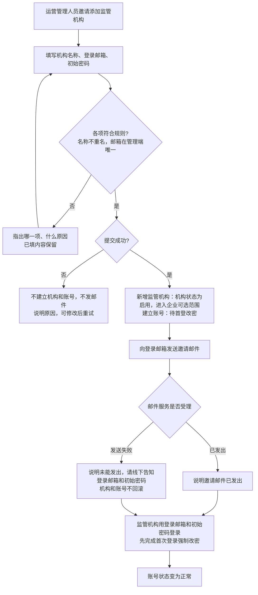
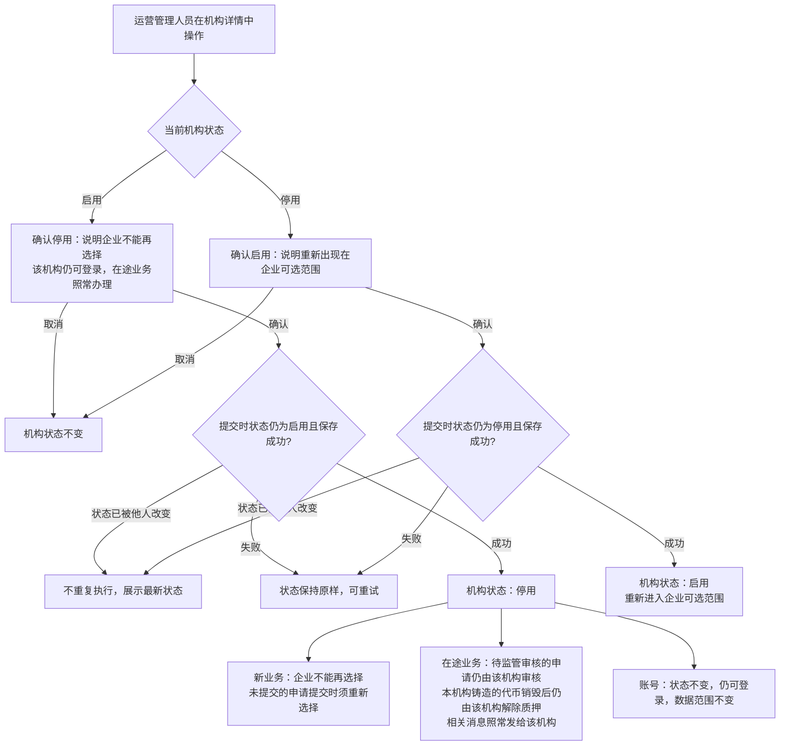
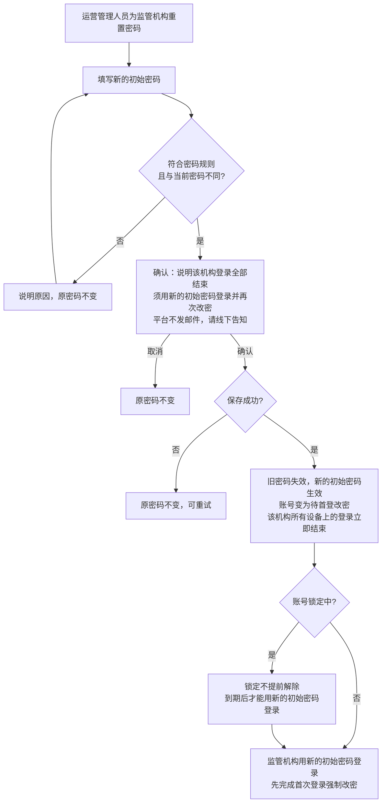
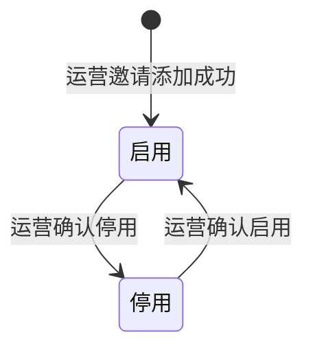

# 监管机构管理 · 流程图与状态机

2026-10-29｜需求评审稿

本册把[功能与业务规则](./v1.0-监管机构管理-PRD.md)中的主要流程与状态画成图，规则以功能册为准。图中方框是业务环节，不代表页面或组件。

| 图 | 内容 | 对应功能 |
| --- | --- | --- |
| [图 1](#fig-1) | 运营邀请添加监管机构、发送邀请邮件，到监管机构首次登录改密 | [邀请添加监管机构（F-RG-02）](./v1.0-监管机构管理-PRD.md#F-RG-02) |
| [图 2](#fig-2) | 停用与启用，以及停用后新业务与在途业务的去向 | [停用与启用（F-RG-05）](./v1.0-监管机构管理-PRD.md#F-RG-05) |
| [图 3](#fig-3) | 重置密码 | [重置密码（F-RG-06）](./v1.0-监管机构管理-PRD.md#F-RG-06) |
| [监管机构状态机](#state-1) | 机构状态在启用与停用之间的变化 | [停用与启用（F-RG-05）](./v1.0-监管机构管理-PRD.md#F-RG-05) |

监管机构账号的状态（待首登改密、正常、锁定）见[管理端账号状态机](./v1.0-管理端登录与权限-流程图与状态机.md#state-1)，本册不重复。

## 邀请添加监管机构（图 1）

## 停用与启用（图 2）

## 重置密码（图 3）

## 监管机构状态机

- 初始状态是启用；没有终态，本期不能删除监管机构。
- 只有启用的机构能被企业选择发起新的发行申请；两种状态下账号都可以登录，已有的在途业务都照常办理。
- 编辑机构信息、重置密码都不改变机构状态。
