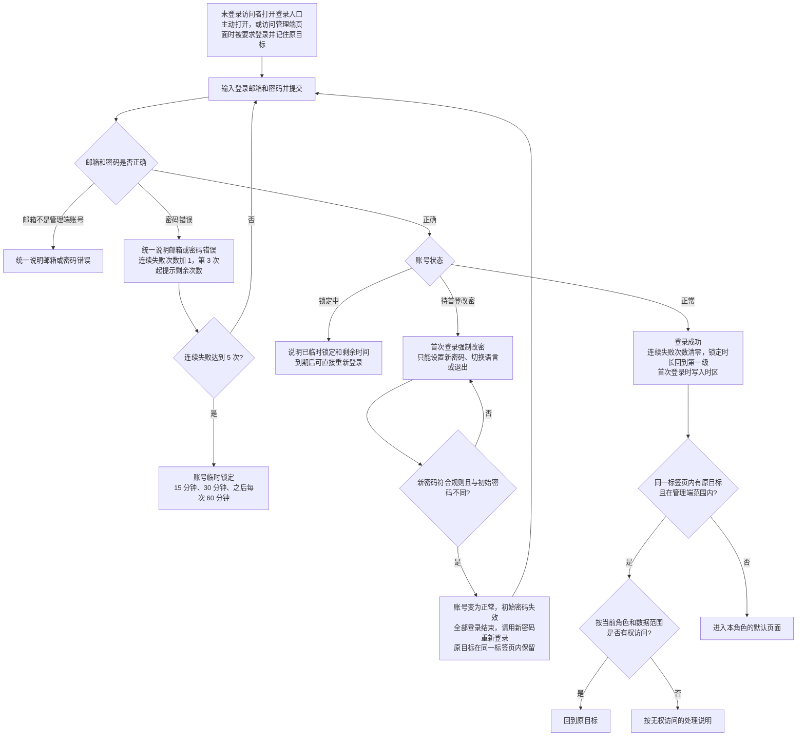
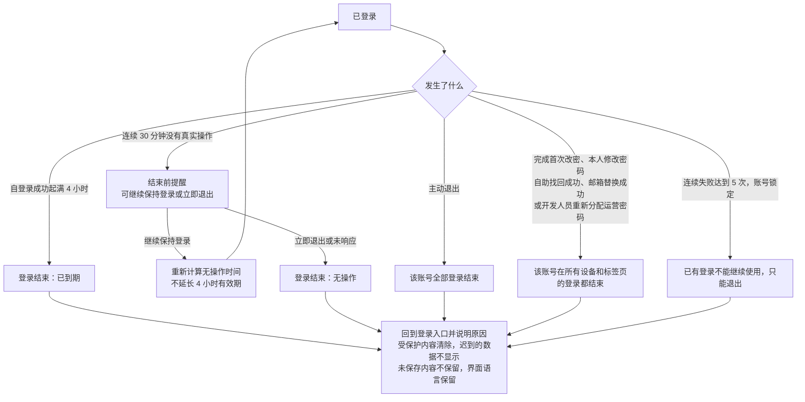
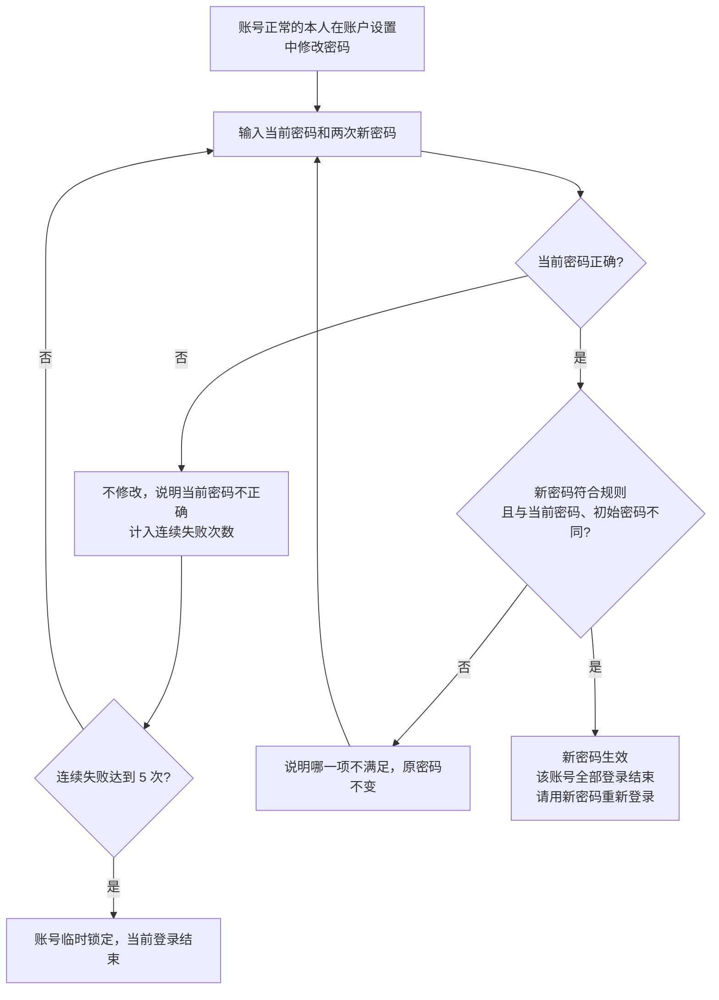
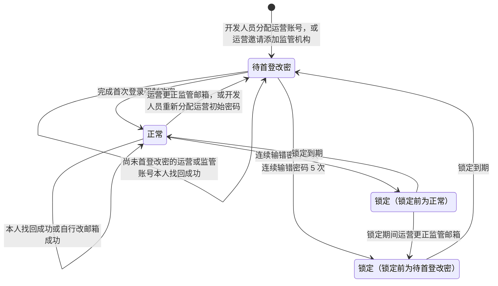
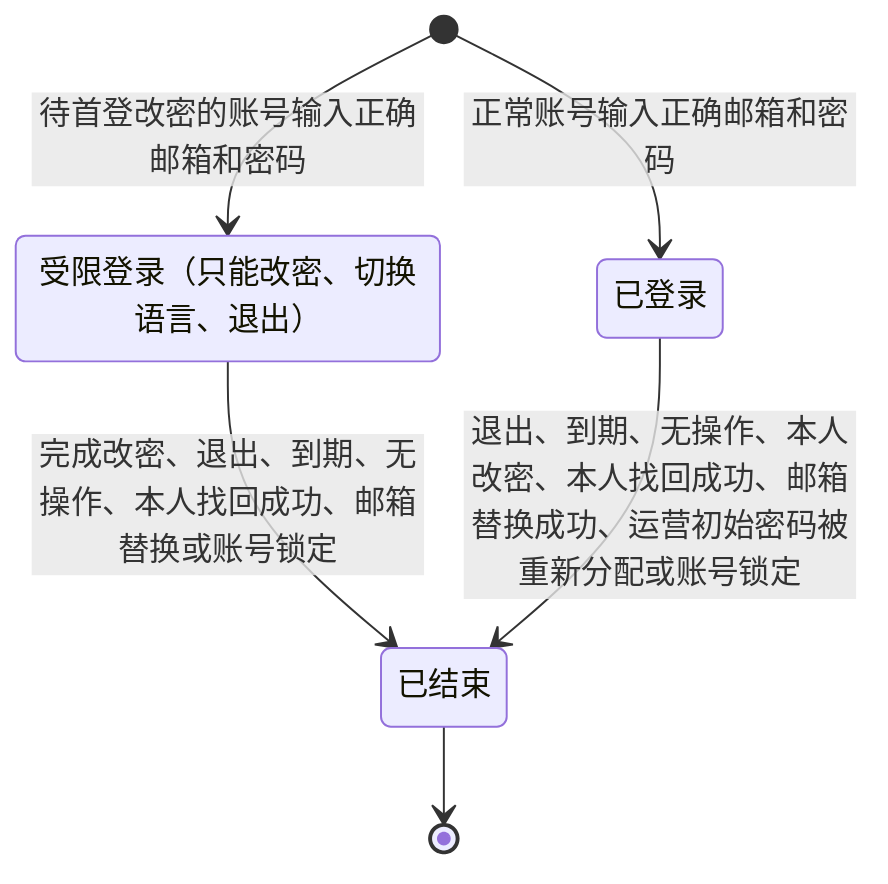
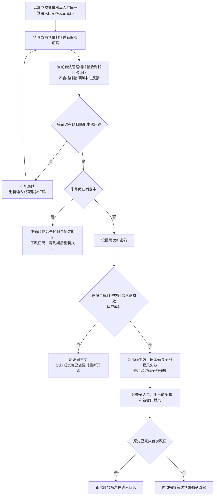
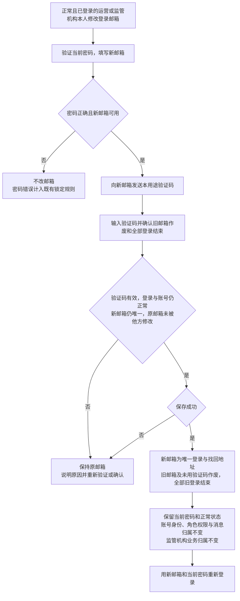
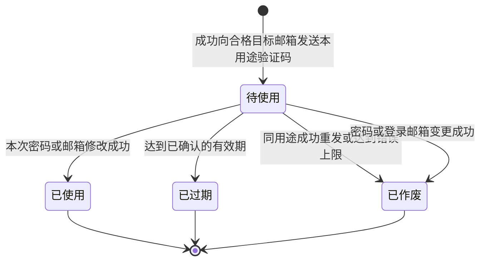

# 管理端登录与权限 · 流程图与状态机

2026-10-30｜需求评审稿

本册把[功能与业务规则](./v1.0-管理端登录与权限-PRD.md)中的主要流程与状态画成图，规则以功能册为准。图中方框是业务环节，不代表页面或组件。

| 图 | 内容 | 对应功能 |
| --- | --- | --- |
| [图 1](#fig-1) | 邮箱与密码登录、锁定判断、首次登录强制改密，以及登录后进入或返回原目标 | [邮箱与密码登录（F-LG-02）](./v1.0-管理端登录与权限-PRD.md#F-LG-02)、[首次登录强制改密（F-LG-03）](./v1.0-管理端登录与权限-PRD.md#F-LG-03)、[登录后进入与返回原目标（F-LG-04）](./v1.0-管理端登录与权限-PRD.md#F-LG-04)、[连续失败与临时锁定（F-LG-05）](./v1.0-管理端登录与权限-PRD.md#F-LG-05) |
| [图 2](#fig-2) | 登录有效期、无操作登出、主动退出与全部登录结束 | [登录有效期、无操作登出与退出（F-LG-06）](./v1.0-管理端登录与权限-PRD.md#F-LG-06) |
| [图 3](#fig-3) | 本人修改密码 | [修改密码（F-LG-08）](./v1.0-管理端登录与权限-PRD.md#F-LG-08) |
| [图 4](#fig-4) | 运营与监管共用的邮箱验证码找回密码 | [自助找回密码（F-LG-13）](./v1.0-管理端登录与权限-PRD.md#F-LG-13) |
| [图 5](#fig-5) | 本人验证新邮箱并使旧邮箱作废 | [本人修改登录邮箱（F-LG-14）](./v1.0-管理端登录与权限-PRD.md#F-LG-14) |
| [验证码状态机](#state-3) | 找回与改邮箱的验证码从发送到失效 | [验证码的共同规则](./v1.0-管理端登录与权限-PRD.md#verification-rules) |
| [管理端账号状态机](#state-1) | 管理端账号在待首登改密、正常、锁定之间的变化 | [账号状态](./v1.0-管理端登录与权限-PRD.md#account-status) |
| [登录状态机](#state-2) | 一次登录从建立到结束 | [登录有效期、无操作登出与退出（F-LG-06）](./v1.0-管理端登录与权限-PRD.md#F-LG-06) |

## 登录与首次改密（图 1）

## 登录有效期、无操作登出与退出（图 2）

## 修改密码（图 3）

## 管理端账号状态机

- 两类账号初始状态均为待首登改密；本人找回与修改邮箱不改变角色或数据归属。本人改邮箱后仍是同一账号，监管机构仍只有一个有效管理端账号；旧邮箱凭据作废、旧登录结束，不再参与该账号的登录与找回。
- 锁定只是临时状态，到期自动回到锁定前的状态；锁定中本人不能完成找回；运营更正邮箱不提前解除锁定，锁定到期后用新邮箱首登改密。
- 监管机构的启用 / 停用是机构的状态，不在本状态机中，见[监管机构状态机](./v1.0-监管机构管理-流程图与状态机.md#state-1)；停用不改变账号状态，账号仍可登录。

## 登录状态机

- 一次登录有效期为 4 小时，连续 30 分钟没有真实操作自动结束；两者先到先结束。
- 受限登录完成改密后直接结束，不会转为已登录；须用新密码重新登录，建立一次新的登录。
- 已结束是终态，不能恢复；之后迟到的操作结果不能让它恢复。

## 管理端找回密码（图 4）

## 本人修改登录邮箱（图 5）

## 验证码状态机

- 验证码按账号、用途与目标邮箱分别有效；更换目标后不能把原目标的码用于新邮箱。
- 已使用、已过期与已作废均为终态；发送失败不产生可用验证码。时效与次数参数见[验证码待确认](./v1.0-管理端登录与权限-PRD.md#Q-LG-01)。
