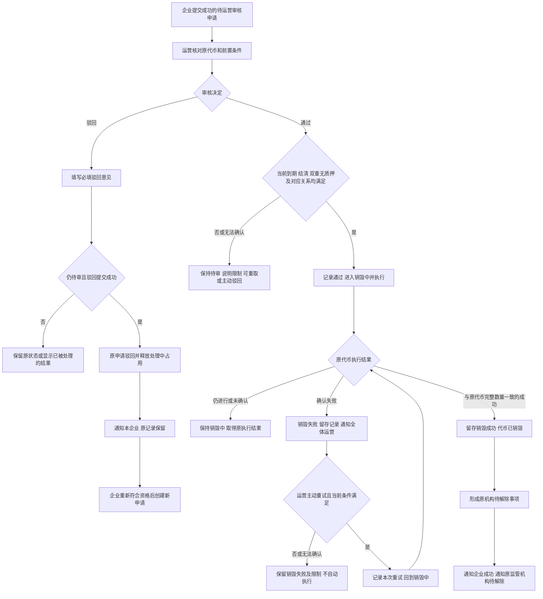
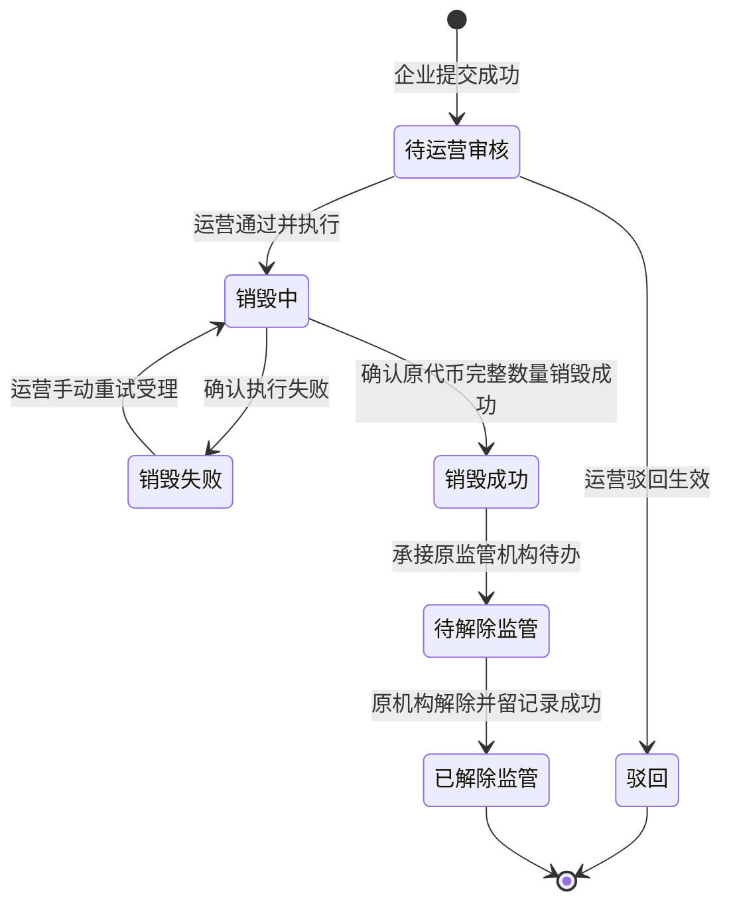
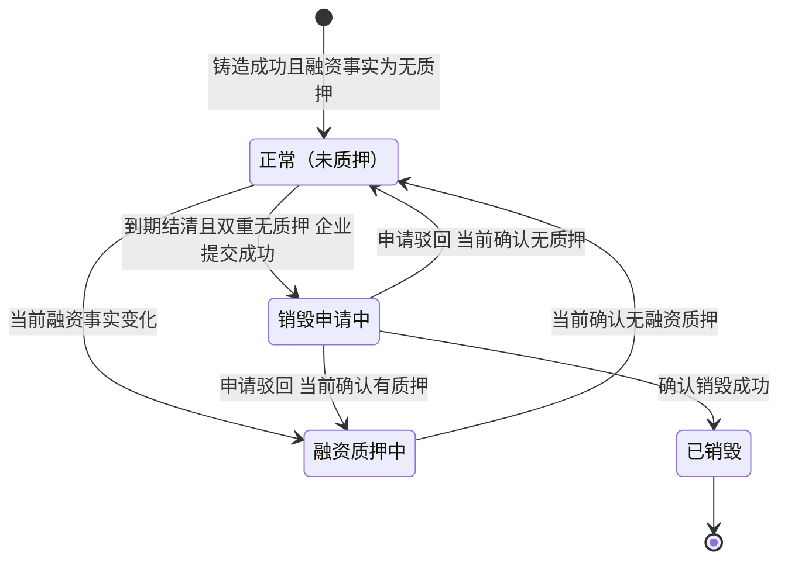
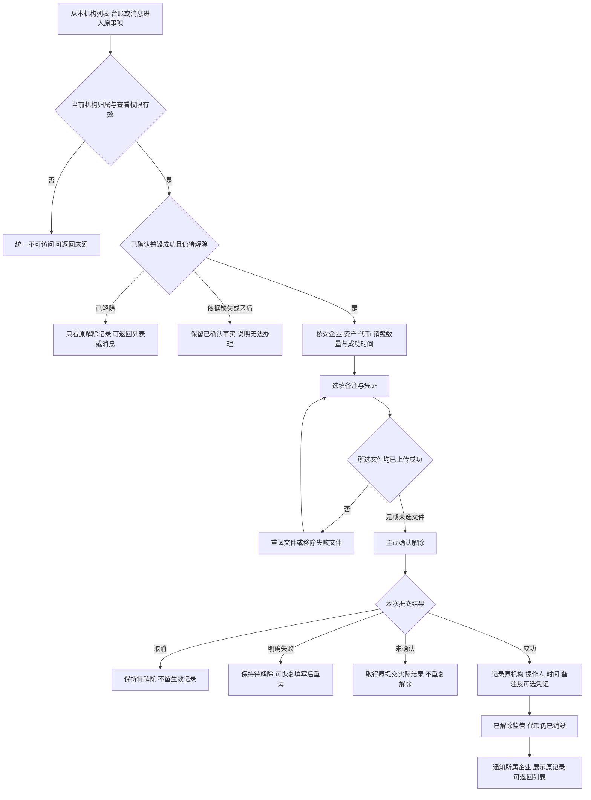

# 销毁审核、解除监管与代币台账 · 流程图与状态机

2026-10-30｜需求评审稿

本册表达业务环节和对象阶段，规则以[01 功能与业务规则](./v1.0-销毁审核与解除质押-PRD.md)为准。监管名称按用户确认表述；“待解除监管”“已解除监管”对应简报第 5 节“待解除资产质押”“已解除质押”。节点不代表页面或组件。

| 图 | 内容 | 对应功能与规则 |
| --- | --- | --- |
| [运营审核与执行（图 1）](#fig-1) | 通过、驳回、失败重试及成功承接 | [条件核对（A-BURN-02）](./v1.0-销毁审核与解除质押-PRD.md#A-BURN-02)、[通过并执行（A-BURN-03）](./v1.0-销毁审核与解除质押-PRD.md#A-BURN-03)、[驳回（A-BURN-04）](./v1.0-销毁审核与解除质押-PRD.md#A-BURN-04)、[重试（A-BURN-05）](./v1.0-销毁审核与解除质押-PRD.md#A-BURN-05) |
| [销毁申请状态（图 2）](#fig-2) | 单笔申请从待审到驳回或解除完成 | [对象与状态对应](./v1.0-销毁审核与解除质押-PRD.md#states) |
| [代币及监管承接（图 3）](#fig-3) | 代币占用、驳回释放、销毁与监管独立 | [状态对应](./v1.0-销毁审核与解除质押-PRD.md#states)、[代币字段](./v1.0-销毁审核与解除质押-PRD.md#handoff-token) |
| [原监管机构解除监管（图 4）](#fig-4) | 本机构核对、可选材料、确认与留记录 | [解除监管详情（R-RELEASE-02）](./v1.0-销毁审核与解除质押-PRD.md#R-RELEASE-02)、[解除并留记录（R-RELEASE-03）](./v1.0-销毁审核与解除质押-PRD.md#R-RELEASE-03) |

## 运营审核与执行（图 1）

重复与并发操作按[共同异常](./v1.0-销毁审核与解除质押-PRD.md#common-errors)只承认一次实际办理；成功事实已确认后，读取或通知异常不能让流程重回销毁。平台停用合约相关通过和重试见[停用合约影响（Q-M4B-01）](./v1.0-销毁审核与解除质押-PRD.md#Q-M4B-01)，该分支尚未裁定。

## 销毁申请状态（图 2）

- 初始为待运营审核；驳回是本笔申请终止，重新发起属于另一笔申请，不画驳回回到待审。
- 销毁失败尚未结束，等待运营手动重试；未确认的执行结果保留销毁中，不因等待而进入失败。
- 销毁成功是持续保留的结果事实，随后为待解除进度；可同次承接，不要求出现独立中间画面。
- 失败说明、次数及解除记录的可见范围以[两端衔接字段清单](./v1.0-销毁审核与解除质押-PRD.md#handoff)为准。

## 代币及监管承接（图 3）

融资信息未知时说明无法确认，资格不通过，不新造“未知”业务终态。申请销毁失败时继续为销毁申请中；驳回释放占用以后依据当前事实判断，新申请不会改写旧驳回记录。

| 代币事实 | 监管事实 | 业务含义 |
| --- | --- | --- |
| 未销毁，包含正常、融资中及销毁申请中 | 监管中 | 原机构持续监管，不能提前解除 |
| 已销毁 | 监管中 | 销毁成功，原机构待解除 |
| 已销毁 | 已解除监管 | 原机构解除成功并留记录，完整业务可回看 |
| 未销毁或销毁结果无法确认 | 出现已解除结果 | 矛盾或缺失，按[共同异常](./v1.0-销毁审核与解除质押-PRD.md#common-errors)核查，不能当作正常可办理 |

监管从原代币铸造成功开始，解除提交成功才结束。资产发行状态始终按 M2 保持已发行，不由销毁或解除回退。

## 原监管机构解除监管（图 4）

文件格式、数量和大小的边界见[填写与凭证边界（Q-M4B-02）](./v1.0-销毁审核与解除质押-PRD.md#Q-M4B-02)；未填备注或未选文件不阻断解除。并发处理中若已由同机构完成，只显示原生效结果，不另留第二份解除记录。
