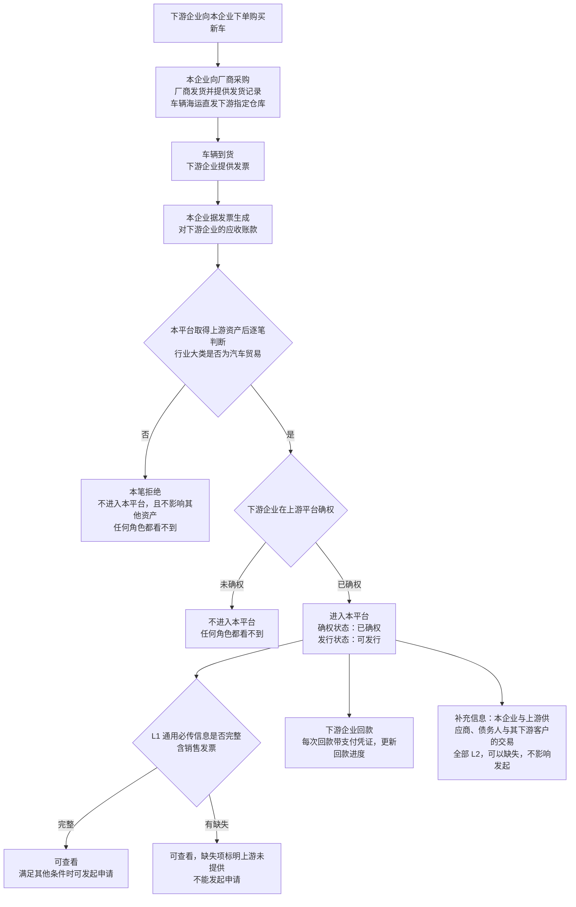
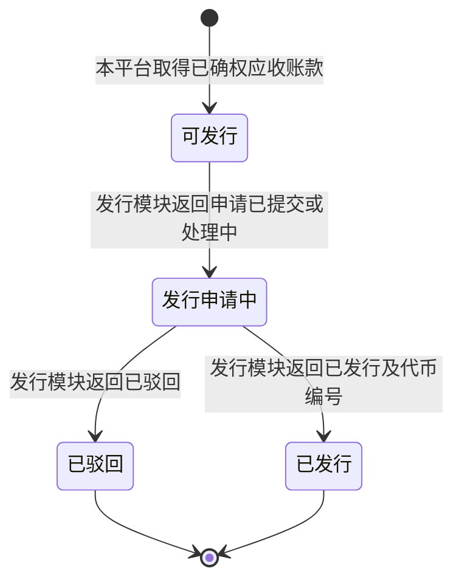
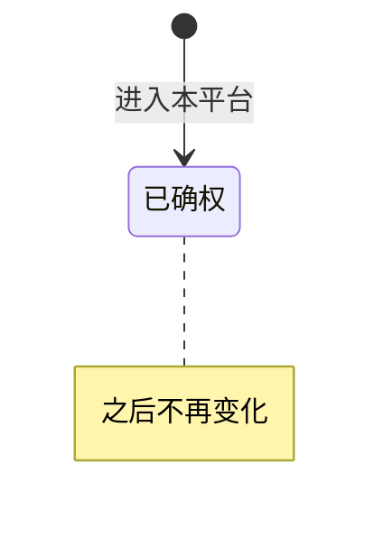
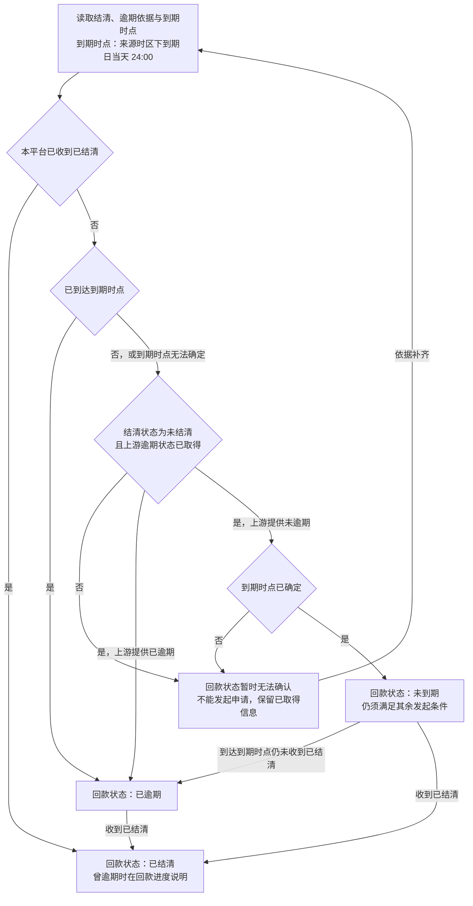
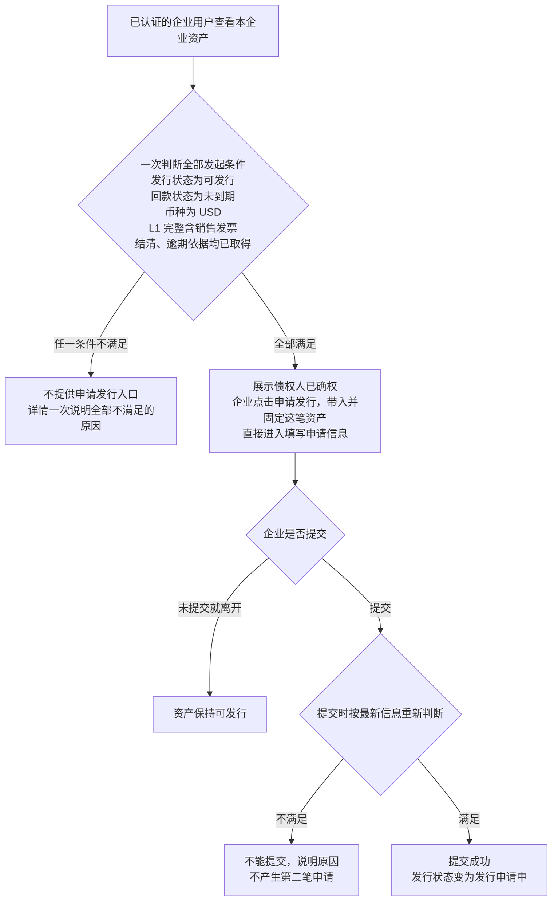
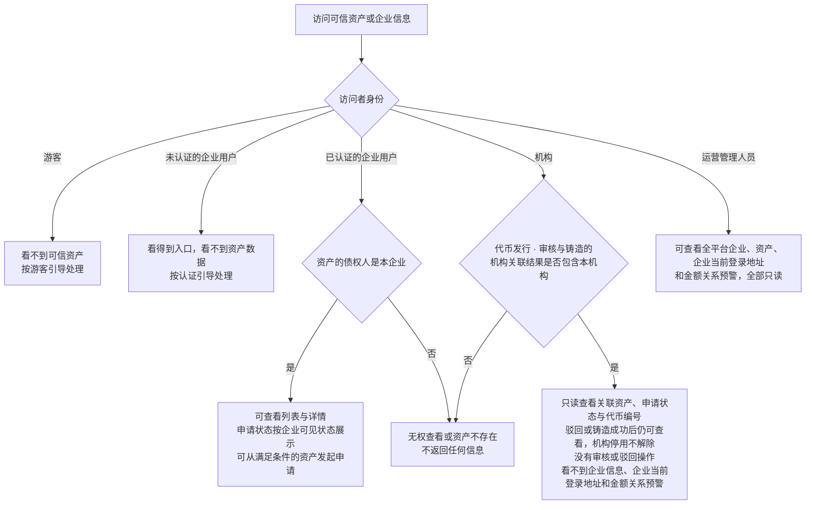

# 可信资产 · 流程图与状态机

2026-11-09｜需求评审稿

本册把[功能与业务规则](./01-可信资产-PRD.md)中的主要流程与状态画成图，规则以功能册为准。图中方框是业务环节或业务状态，不代表页面或组件。资产统一展示确权、回款、发行三个状态，回款状态按上游结清、逾期依据归并。图号沿用原值，已删除的图不再占号，缺号不代表遗漏。

| 图 | 内容 | 对应功能 |
| --- | --- | --- |
| [可信资产的来源与进入本平台（图 1）](#fig-1) | 应收账款从业务发生到本平台取得资产、逐笔准入、核心与补充信息的完整性要求，以及之后的回款 | [资产进入本平台与信息结构（F-AS-01）](./01-可信资产-PRD.md#F-AS-01) |
| [发行状态（图 2）](#fig-2) | 资产的发行状态与推动环节 | [发行状态](./01-可信资产-PRD.md#issue-status) |
| [确权与回款状态（图 4）](#fig-4) | 确权状态、回款状态归并及到期判断 | [确权状态](./01-可信资产-PRD.md#confirm-status)、[回款状态归并](./01-可信资产-PRD.md#repayment-status) |
| [从可信资产发起发行申请（图 5）](#fig-5) | 企业发起申请时一次判断全部条件及结果 | [从可信资产发起发行申请（F-AS-04）](./01-可信资产-PRD.md#F-AS-04) |
| [各角色的查看范围（图 6）](#fig-6) | 企业、运营、机构能看到哪些资产与企业信息 | [企业查看本企业可信资产（F-AS-03）](./01-可信资产-PRD.md#F-AS-03)、[运营查看企业与资产（F-AS-05）](./01-可信资产-PRD.md#F-AS-05)、[机构查看关联资产（F-AS-06）](./01-可信资产-PRD.md#F-AS-06) |

## 可信资产的来源与进入本平台（图 1）

## 发行状态（图 2）

初始状态为“可发行”；“已驳回”和“已发行”是终态。申请提交成功后，在发行模块返回最终结果前保持“发行申请中”。发行模块内部的机构分配、处理、驳回和发行执行流程不在本图展开；本模块只消费其返回的结果。申请处于铸造中或铸造失败时，资产保持“发行申请中”。发行成功后的资产托管、融资和销毁属于代币，不改变资产发行状态。

## 确权与回款状态（图 4）

确权、结清、逾期事实都由上游平台提供；回款状态归并表达当前结果，与发行状态互不推动。进入本平台的资产始终为“已确权”，之后不再变化。到期时点是来源时区下到期日当天 24:00，查看者所选时区只影响展示。

判断以[结清与逾期依据](./01-可信资产-PRD.md#overdue)及其中的[到期时点](./01-可信资产-PRD.md#due-time)为准；上游没有推送或暂时不可用，都不影响到期后判为已逾期。原始依据继续保留。已结清的资产不再因到期回到已逾期，先逾期后结清按当前已结清筛选。

## 从可信资产发起发行申请（图 5）

不满足的原因按[从可信资产发起发行申请（F-AS-04）](./01-可信资产-PRD.md#F-AS-04)一次列全，包括已有申请处理中、申请已被驳回、已发行、资产已逾期、资产已结清、仅支持美元计价的资产、资产信息不完整、暂时无法确认资产状态。累计已回款、未回款余额、应收账款金额或结清状态之间的金额关系异常不进入上述条件，不阻断申请；仅在运营端按[运营端金额关系预警](./01-可信资产-PRD.md#amount-warning)提示。

## 各角色的查看范围（图 6）

