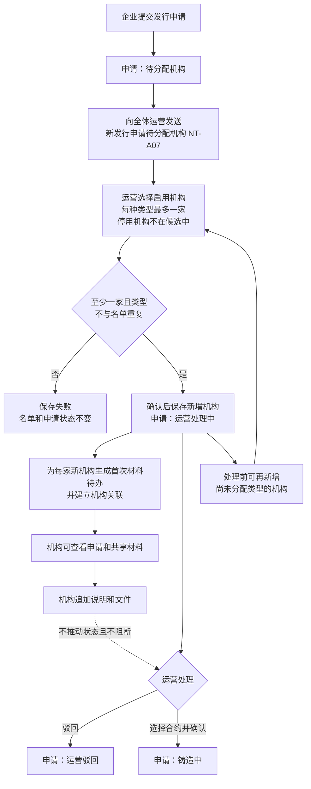
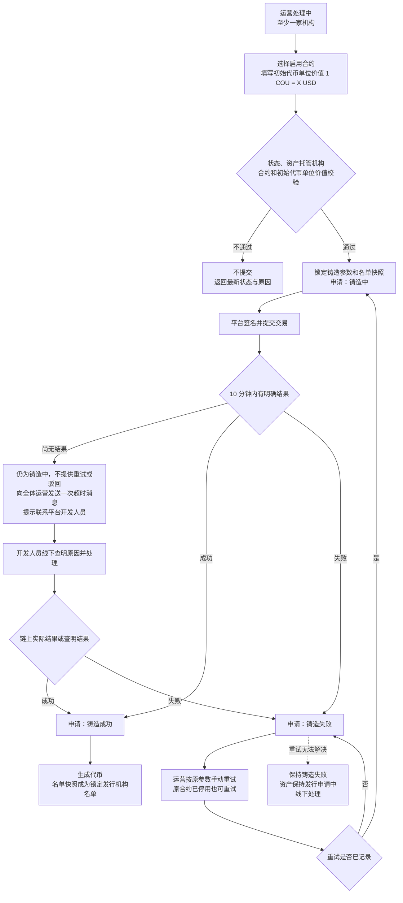
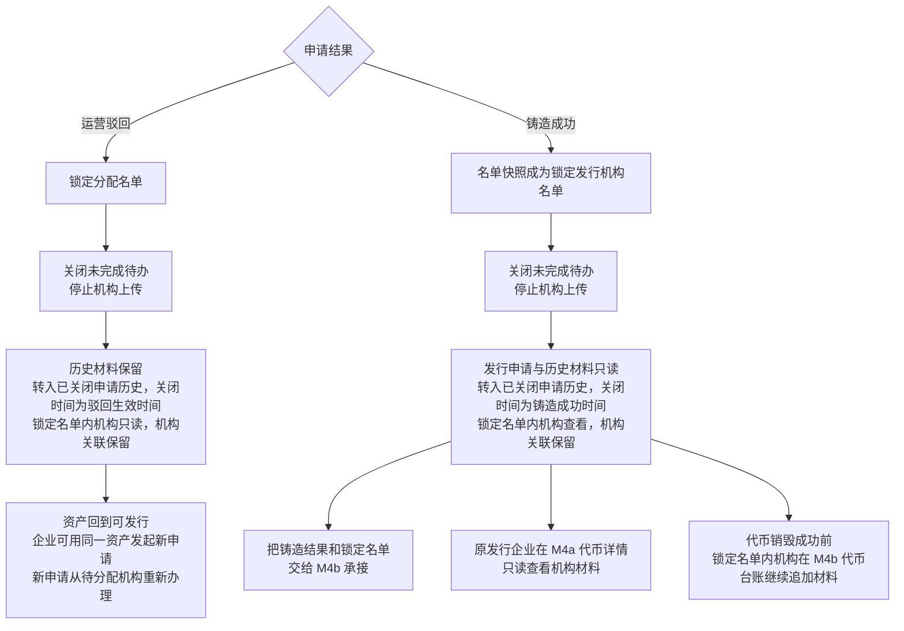
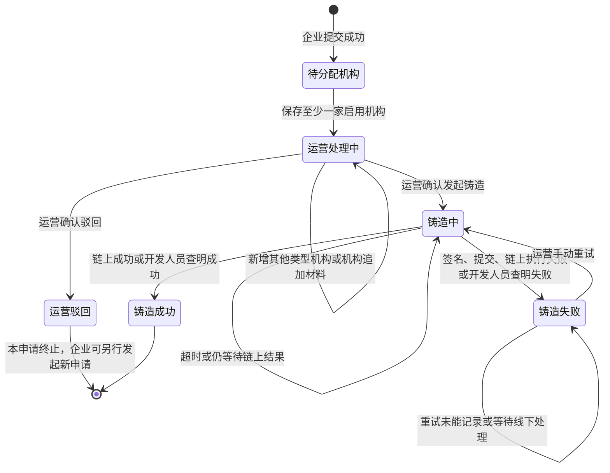
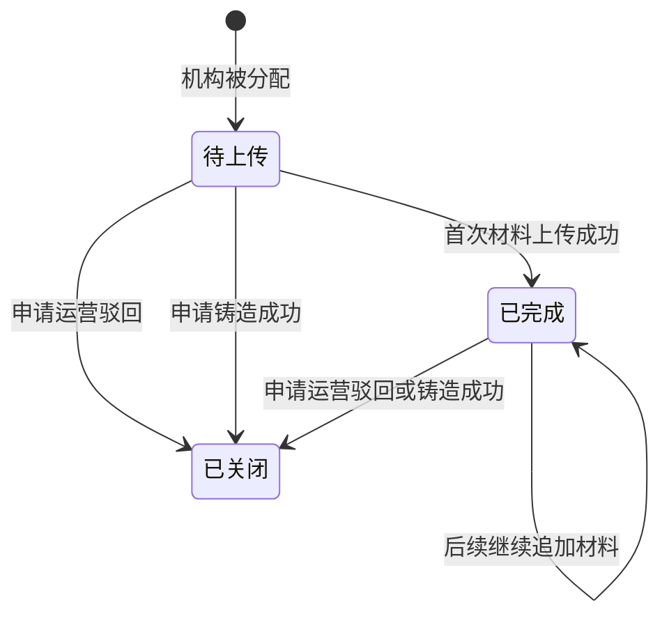

# 代币发行 · 审核与铸造 · 流程图与状态机

2026-11-10｜管理端：运营管理人员、机构账号｜需求评审稿

本册只画 [01 功能与业务规则](./01-代币发行-审核与铸造-PRD.md)中已定义的流程和状态；消息见 [03 消息通知](./03-代币发行-审核与铸造-消息通知.md)，验收见 [04 验收](./04-代币发行-审核与铸造-验收.md)。

## 图册索引

| 图 | 内容 | 对应功能 |
|---|---|---|
| [图 1](#fig-1) | 企业提交、待分配提醒、机构分配、运营处理与机构材料并行 | [分配机构（A-ISSUE-08）](./01-代币发行-审核与铸造-PRD.md#A-ISSUE-08)、[机构材料待办与追加（R-ISSUE-06）](./01-代币发行-审核与铸造-PRD.md#R-ISSUE-06)、[运营驳回（A-ISSUE-05）](./01-代币发行-审核与铸造-PRD.md#A-ISSUE-05) |
| [图 2](#fig-2) | 发起铸造、超时线下查明、失败和重试 | [选择合约并发起铸造（A-ISSUE-04）](./01-代币发行-审核与铸造-PRD.md#A-ISSUE-04)、[铸造结果（A-ISSUE-06）](./01-代币发行-审核与铸造-PRD.md#A-ISSUE-06)、[铸造失败手动重试（A-ISSUE-07）](./01-代币发行-审核与铸造-PRD.md#A-ISSUE-07) |
| [图 3](#fig-3) | 发行处理结束后的名单、关联与材料收口 | [运营驳回（A-ISSUE-05）](./01-代币发行-审核与铸造-PRD.md#A-ISSUE-05)、[铸造结果（A-ISSUE-06）](./01-代币发行-审核与铸造-PRD.md#A-ISSUE-06)、[已关闭申请的历史](./01-代币发行-审核与铸造-PRD.md#closed-history)、[机构关联结果](./01-代币发行-审核与铸造-PRD.md#institution-link) |
| [状态机 1](#state-1) | 发行申请真实状态 | [申请状态与动作](./01-代币发行-审核与铸造-PRD.md#status) |
| [状态机 2](#state-2) | 机构首次材料待办状态 | [机构材料待办与追加（R-ISSUE-06）](./01-代币发行-审核与铸造-PRD.md#R-ISSUE-06) |

## 先分配机构，再由运营处理（图 1）

规则：

- 机构不经过“发行审核”，不提供通过、驳回或材料齐全结论。
- 企业提交成功、申请进入待分配机构时，向全体运营发送一条待分配消息。
- 待分配机构时只能查看和分配；绕过界面的驳回、铸造提交同样拒绝。
- 一家或多家启用机构均可进入运营处理中，不要求三类齐全；每种机构类型最多一家。
- 运营驳回不要求资产托管机构；发起铸造前名单中须有一家资产托管机构。
- 分配只能新增，不能移除或替换；误分配只能驳回。首次分配成功后申请不再回到待分配机构。
- 分配后机构材料与运营处理并行；零材料也可驳回或发起铸造。

## 铸造、超时与重试（图 2）

规则：

- 名单中没有资产托管机构时不提交，运营可先新增资产托管机构或驳回；已分配的资产托管机构后来停用仍满足。
- 进入铸造中后不能驳回、新增机构或重复发起。
- 超时不是失败；状态不变，平台不提供重试或驳回；由开发人员线下查明，平台按链上实际结果或查明结果收口。
- 失败后只允许沿用原合约、接收地址、价值、数量和名单快照重试，不重新校验资产托管机构前提；原合约已被平台停用不阻断重试。
- 铸造失败没有驳回或终止出口；重试无法解决时申请保持铸造失败，由线下处理。
- 重试未能记录时不生效，申请保持铸造失败；平台不自动重试。
- 多人并发发起或重试，只允许第一笔有效提交生效。

## 发行处理结束后的名单与材料收口（图 3）

运营驳回不产生代币权限，企业也看不到该申请的机构材料。铸造成功后，原发行企业按[申请与文件访问范围](./01-代币发行-审核与铸造-PRD.md#file-access)只读查看机构材料；代币数据范围、资产托管、解除资产托管和后续材料由 M4b 按锁定名单定义，铸造成功后、代币销毁成功前的材料追加见[铸造后追加机构材料（R-TOKEN-02）](../M4b-销毁审核与解除质押/01-销毁审核与解除质押-PRD.md#R-TOKEN-02)；本模块不授予这些权限。

## 发行申请状态机（状态机 1）

机构上传材料、首次待办完成、已分配机构停用和机构类型变化都不推动发行申请状态；首次成功分配后名单只增不减，申请不再回到待分配机构。两个内部状态在企业端都显示“运营处理中”。发行申请只有运营可以驳回，机构没有发行审核状态或结果。铸造中超时不改变状态；铸造失败只有手动重试一个出口，没有驳回或终止，重试无法解决时由线下处理。

## 首次材料待办状态机（状态机 2）

待办状态与发行申请状态相互独立。只有首次成功上传才完成待办；运营驳回或铸造成功都会关闭待办并停止本模块继续上传；铸造成功后的追加改在 M4b 办理，见[铸造后追加机构材料（R-TOKEN-02）](../M4b-销毁审核与解除质押/01-销毁审核与解除质押-PRD.md#R-TOKEN-02)，不产生本模块待办。待上传、已完成的申请留在待办列表并可按首次材料状态筛选；已关闭的申请转入[已关闭申请的历史](./01-代币发行-审核与铸造-PRD.md#closed-history)，记录关闭时间，可按申请结果筛选。
