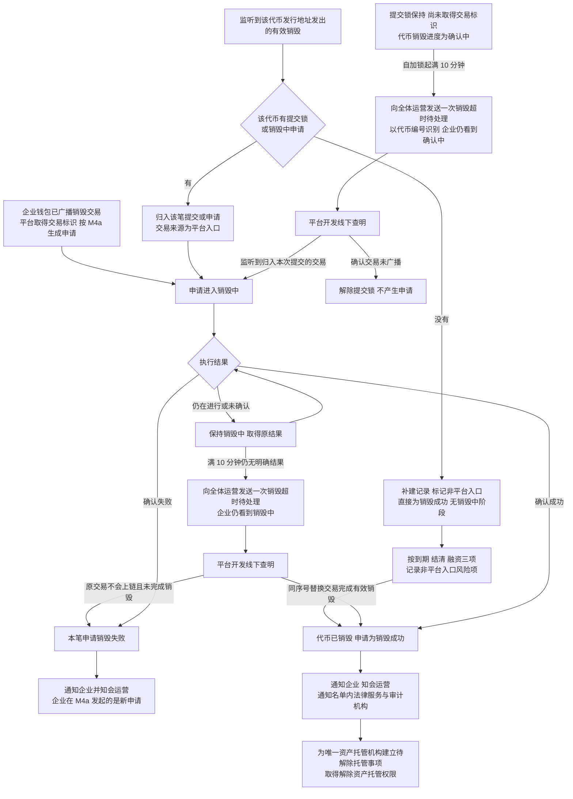
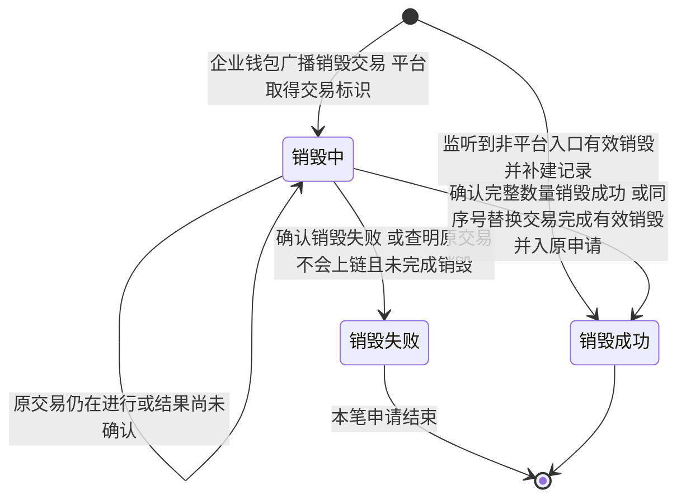
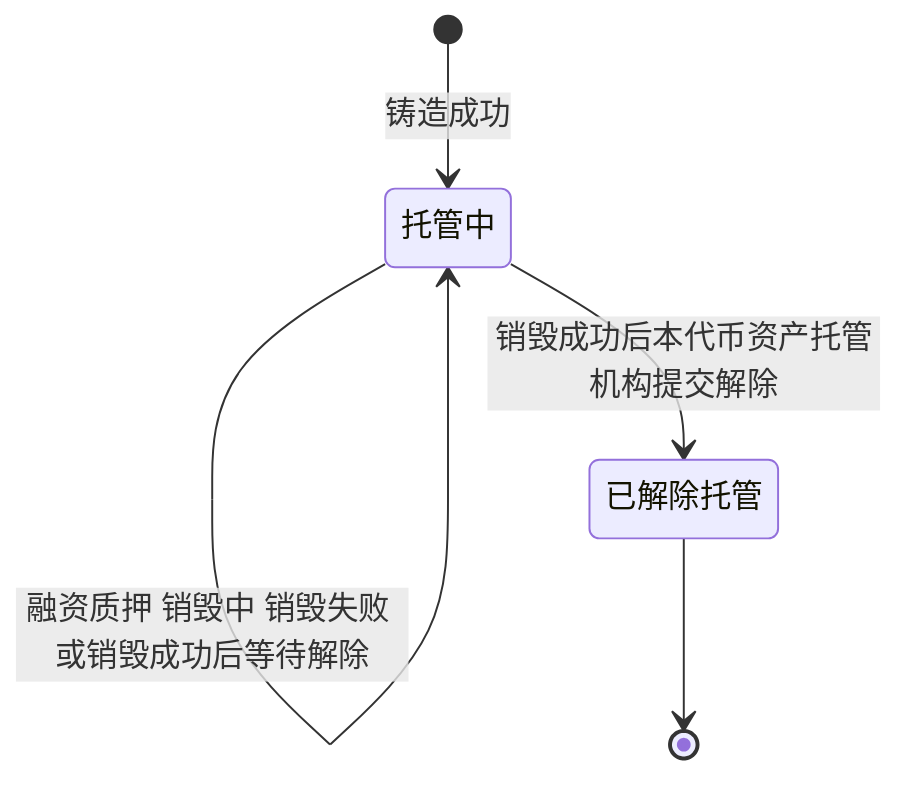
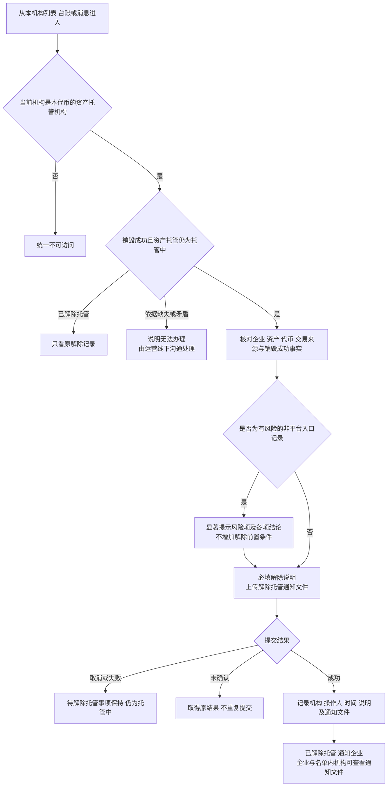
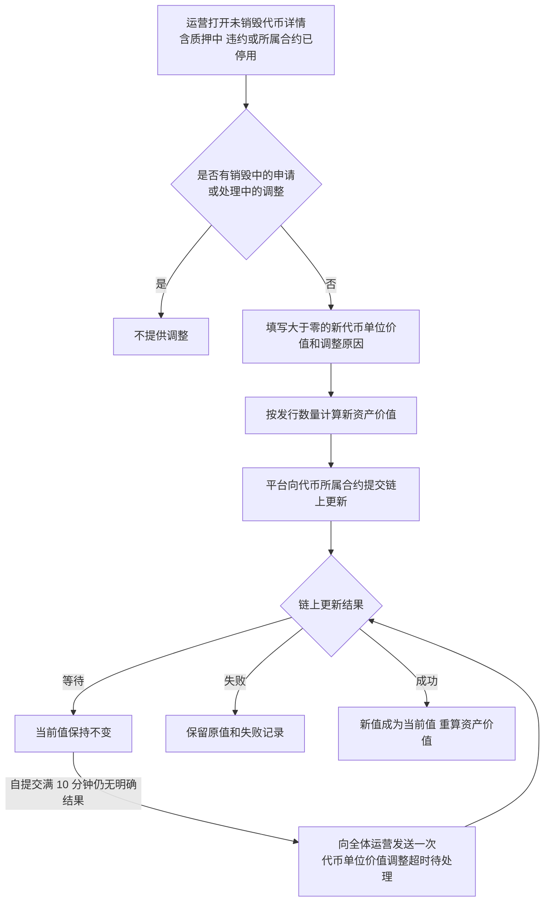
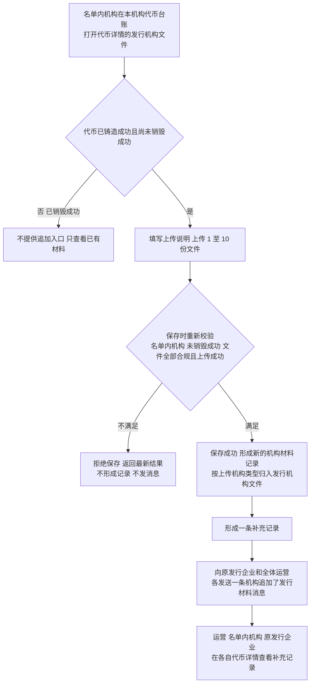

# 销毁执行、解除资产托管与代币台账 · 流程图与状态机

2026-11-10｜需求评审稿

本册表达业务环节和对象状态，规则以[01 功能与业务规则](./01-销毁审核与解除质押-PRD.md)为准。节点不代表页面或组件。销毁申请状态只有销毁中、销毁失败、销毁成功；资产托管状态只有托管中、已解除托管；“待解除托管”是资产托管机构的待办事项，不是状态。

| 图 | 内容 | 对应规则 |
| --- | --- | --- |
| [销毁结果承接（图 1）](#fig-1) | 企业钱包已广播或监听到链上销毁后的归属、结果、超时与通知，以及提交锁长时间未收口 | [销毁结果承接（A-BURN-03）](./01-销毁审核与解除质押-PRD.md#A-BURN-03) |
| [销毁申请状态（图 2）](#fig-2) | 单笔申请从销毁中或非平台入口补建到失败或成功 | [对象与状态对应](./01-销毁审核与解除质押-PRD.md#states) |
| [资产托管状态（图 3）](#fig-3) | 资产托管从铸造成功到解除完成 | [代币及关联事实](./01-销毁审核与解除质押-PRD.md#handoff-token) |
| [资产托管机构解除资产托管（图 4）](#fig-4) | 核对、风险提示、提交与留记录 | [解除资产托管并留记录（R-RELEASE-03）](./01-销毁审核与解除质押-PRD.md#R-RELEASE-03) |
| [代币单位价值调整（图 5）](#fig-5) | 链上生效、失败保留原值与超时提醒 | [调整代币单位价值（A-TOKEN-02）](./01-销毁审核与解除质押-PRD.md#A-TOKEN-02) |
| [铸造后追加机构材料（图 6）](#fig-6) | 名单内机构追加材料、形成补充记录并通知企业与运营 | [铸造后追加机构材料（R-TOKEN-02）](./01-销毁审核与解除质押-PRD.md#R-TOKEN-02)、[补充记录](./01-销毁审核与解除质押-PRD.md#supplement-records) |

## 销毁结果承接（图 1）

企业资格校验、提交锁、钱包签名与提交见 M4a [校验、签名与提交（图 2）](../../面客端/M4a-我的代币与销毁申请/02-我的代币与销毁申请-流程图与状态机.md#fig-2)。运营只在链上成功、失败、销毁中满 10 分钟或提交锁满 10 分钟仍未取得交易标识时收到消息并只读查看记录，不出现发起、审核、驳回、手动重试或线上超时处理节点。替换交易完成销毁时并入原申请，不另建非平台入口记录。新申请是新业务事实，不把原失败申请恢复为销毁中。

## 销毁申请状态（图 2）

本图与 M4a [销毁申请状态与资产托管状态（图 3）](../../面客端/M4a-我的代币与销毁申请/02-我的代币与销毁申请-流程图与状态机.md#fig-3)一致。失败申请不再迁回销毁中；企业后续新申请从新的销毁中开始。非平台入口补建记录没有销毁中阶段，销毁中起始时间为空。销毁成功与解除资产托管是先后两个事实，成功不等于已解除。

## 资产托管状态（图 3）

资产托管从铸造成功开始，只有本代币的资产托管机构提交解除成功才结束。代币销毁成功后，资产托管机构收到一项待解除托管事项，资产托管状态仍为托管中；待解除托管事项是待办，不是状态。违约或质押中代币保持托管中，不形成解除事项。代币持有、融资与资产托管的关系见 M4a [代币持有、融资与资产托管的关系（图 4）](../../面客端/M4a-我的代币与销毁申请/02-我的代币与销毁申请-流程图与状态机.md#fig-4)。

## 资产托管机构解除资产托管（图 4）

资产托管机构长期不办理时，平台不催办，由运营线下沟通处理。

## 代币单位价值调整（图 5）

调价只改变代币单位价值和由其计算的资产价值，不改发行数量、原始资产价值、持有、融资、销毁或托管状态；链上更新能力与约束按 M6 [代币单位价值链上更新（F-CT-07）](../M6-合约管理/01-合约管理-PRD.md#F-CT-07)。超时提醒不代表失败，平台不自动判失败，结果确认后按实际结果收口，见[调整长时间没有结果](./01-销毁审核与解除质押-PRD.md#adjust-timeout)。

## 铸造后追加机构材料（图 6）

一次保存多份文件只形成一条补充记录，企业与运营各收一条消息；其他名单内机构不收消息。追加不改变代币、销毁申请或资产托管状态。铸造成功前经 M3b 上传的材料和资产托管机构上传的解除托管通知文件都不形成补充记录，也不发送这两条消息。规则见[铸造后追加机构材料（R-TOKEN-02）](./01-销毁审核与解除质押-PRD.md#R-TOKEN-02)与[补充记录](./01-销毁审核与解除质押-PRD.md#supplement-records)，消息见[机构追加了发行材料（NT-C11）](./03-销毁审核与解除质押-消息通知.md#NT-C11)与[机构追加了发行材料（NT-A10）](./03-销毁审核与解除质押-消息通知.md#NT-A10)。
