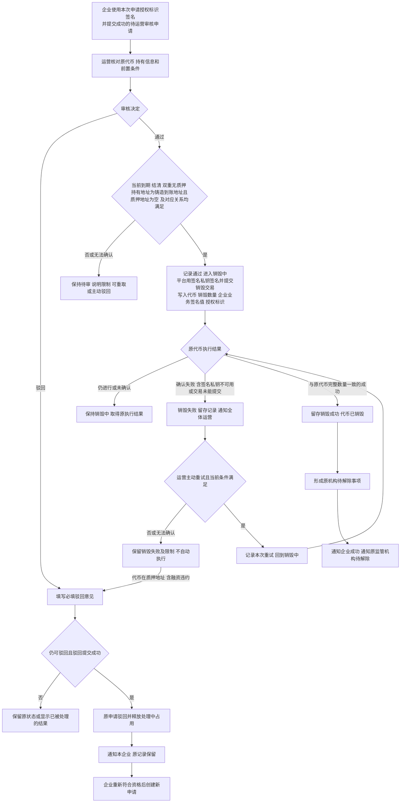
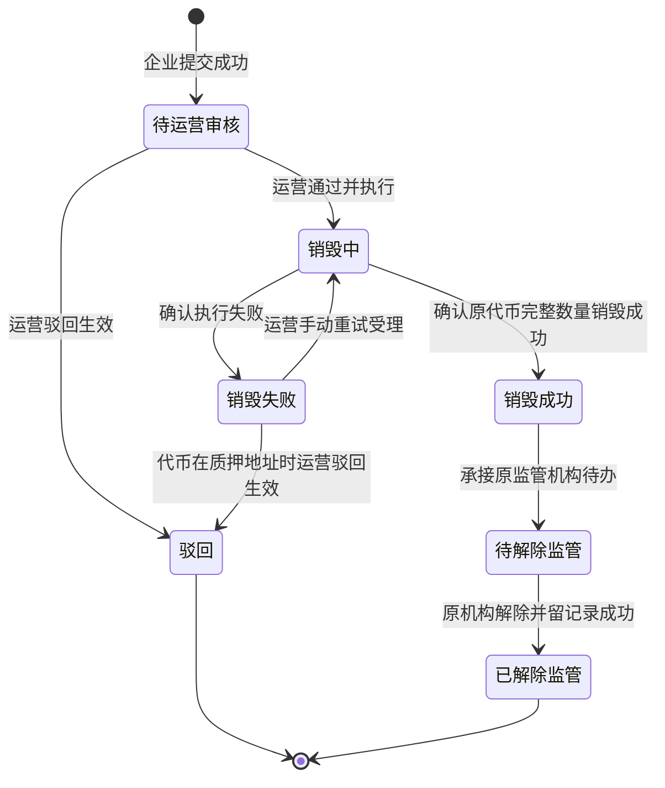
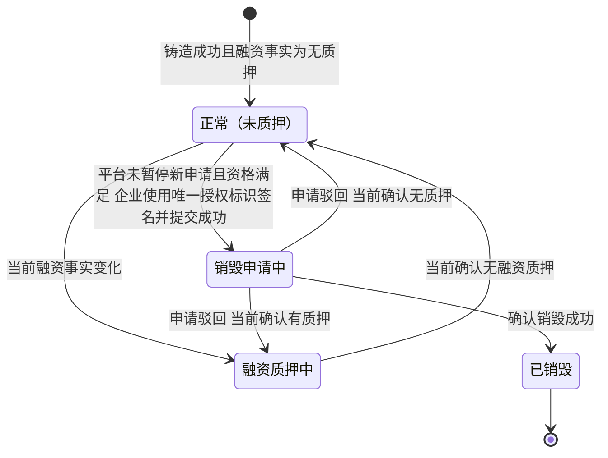
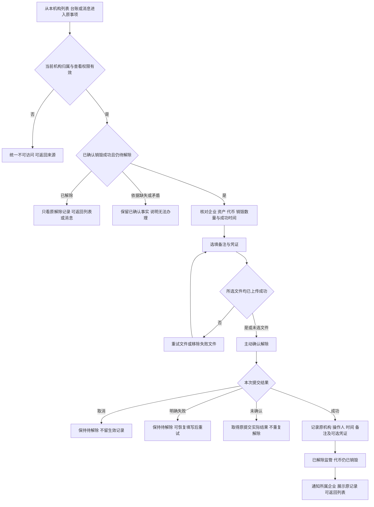
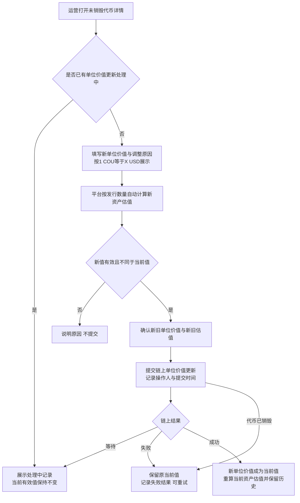

# 销毁审核、解除监管与代币台账 · 流程图与状态机

2026-11-06｜需求评审稿

本册表达业务环节和对象阶段，规则以[01 功能与业务规则](./01-销毁审核与解除质押-PRD.md)为准。销毁申请阶段引用简报第 5 节；本平台只有监管，监管相关阶段称为待解除监管、已解除监管。节点不代表页面或组件。

| 图 | 内容 | 对应功能与规则 |
| --- | --- | --- |
| [运营审核与执行（图 1）](#fig-1) | 通过、驳回、失败重试及成功承接 | [条件核对（A-BURN-02）](./01-销毁审核与解除质押-PRD.md#A-BURN-02)、[通过并执行（A-BURN-03）](./01-销毁审核与解除质押-PRD.md#A-BURN-03)、[驳回（A-BURN-04）](./01-销毁审核与解除质押-PRD.md#A-BURN-04)、[重试（A-BURN-05）](./01-销毁审核与解除质押-PRD.md#A-BURN-05) |
| [销毁申请状态（图 2）](#fig-2) | 单笔申请从待审到驳回或解除完成 | [对象与状态对应](./01-销毁审核与解除质押-PRD.md#states) |
| [代币及监管承接（图 3）](#fig-3) | 代币占用、驳回释放、销毁与监管独立 | [状态对应](./01-销毁审核与解除质押-PRD.md#states)、[代币字段](./01-销毁审核与解除质押-PRD.md#handoff-token) |
| [原监管机构解除监管（图 4）](#fig-4) | 本机构核对、可选材料、确认与留记录 | [解除监管详情（R-RELEASE-02）](./01-销毁审核与解除质押-PRD.md#R-RELEASE-02)、[解除并留记录（R-RELEASE-03）](./01-销毁审核与解除质押-PRD.md#R-RELEASE-03) |
| [代币单位价值调整（图 5）](#fig-5) | 运营逐笔调价、链上生效与失败保留原值 | [调整代币单位价值（A-TOKEN-02）](./01-销毁审核与解除质押-PRD.md#A-TOKEN-02) |

## 运营审核与执行（图 1）

重复与并发操作按[共同异常](./01-销毁审核与解除质押-PRD.md#common-errors)只承认一次实际办理；成功事实已确认后，读取或通知异常不能让流程重回销毁。通过与重试均由平台签名并提交销毁交易，写入原申请的业务签名值和本次申请授权标识，运营与企业不使用钱包，见[平台签名提交销毁交易](./01-销毁审核与解除质押-PRD.md#platform-signing)。审核阶段直接驳回不提交交易；已提交交易但执行失败后驳回时，原失败交易中的签名值和授权标识保留，不代表销毁成功，也不新增交易。平台暂停新的销毁申请不改变既有申请阶段，运营仍按当前条件办理；必要依据无法确认时不能通过或重试。平台停用不阻断既有代币的销毁申请、通过、执行和原申请手动重试，无需先启用，见[停用与既有业务](../M6-合约管理/01-合约管理-PRD.md#inflight)；实际链上异常仍按执行结果处理。

## 销毁申请状态（图 2）

- 初始为待运营审核；驳回是本笔申请终止，再次申请销毁属于另一笔申请，不画驳回回到待审。
- 销毁失败尚未结束，等待运营手动重试；代币在质押地址（含融资违约）时不能重试，运营可填写意见驳回结束；未确认的执行结果保留销毁中，不因等待而进入失败。
- 销毁成功是持续保留的结果事实，随后为待解除进度；可同次承接，不要求出现独立中间画面。
- 失败说明、次数及解除记录的可见范围以[两端衔接字段清单](./01-销毁审核与解除质押-PRD.md#handoff)为准。

## 代币及监管承接（图 3）

融资信息未知时说明无法确认，资格不通过，不新造“未知”业务终态。申请销毁失败时继续为销毁申请中；驳回释放占用以后依据当前事实判断，新申请不会改写旧驳回记录。

| 代币事实 | 监管事实 | 业务含义 |
| --- | --- | --- |
| 未销毁，包含正常、融资中及销毁申请中 | 监管中 | 原机构持续监管，不能提前解除 |
| 已销毁 | 监管中 | 销毁成功，原机构待解除 |
| 已销毁 | 已解除监管 | 原机构解除成功并留记录，完整业务可回看 |
| 未销毁或销毁结果无法确认 | 出现已解除结果 | 矛盾或缺失，按[共同异常](./01-销毁审核与解除质押-PRD.md#common-errors)核查，不能当作正常可办理 |

监管从原代币铸造成功开始，解除提交成功才结束。资产发行状态始终按 M2 保持已发行，不由销毁或解除回退。

## 原监管机构解除监管（图 4）

本期不设备注长度上限，也不限定凭证的格式、份数和大小，见[解除监管并留记录（R-RELEASE-03）](./01-销毁审核与解除质押-PRD.md#R-RELEASE-03)；未填备注或未选文件不阻断解除。并发处理中若已由同机构完成，只显示原生效结果，不另留第二份解除记录。

## 代币单位价值调整（图 5）

调价只改变当前单位价值和由其计算的当前资产估值；发行数量、应收账款原值、持有、融资、销毁与监管状态均不改变。具体链上承载方式由研发确定，产品只要求链上成功后才生效。
