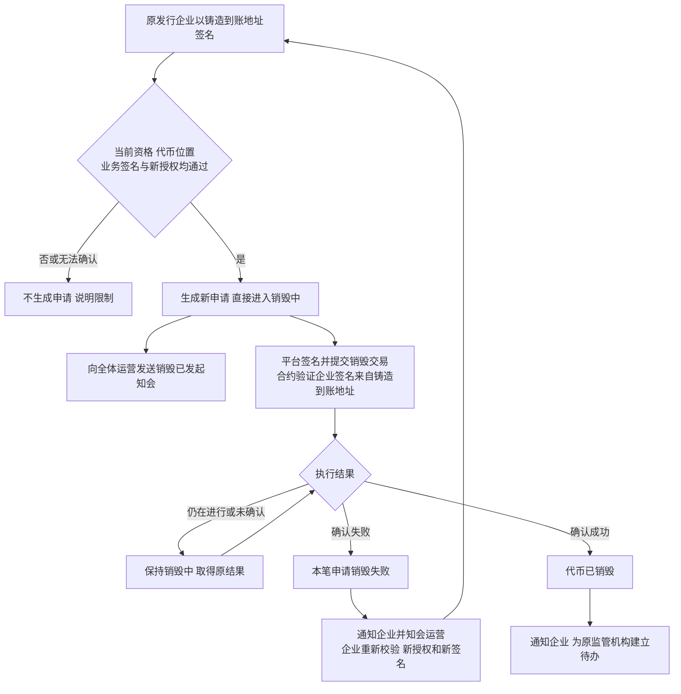
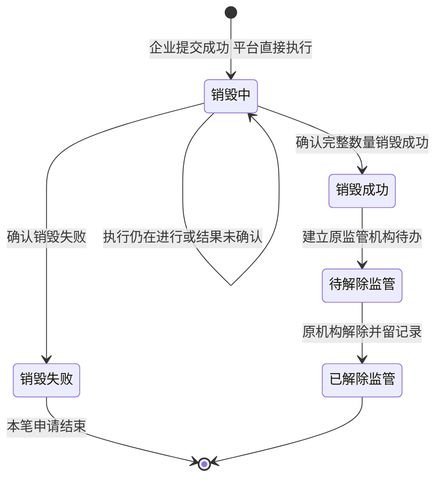
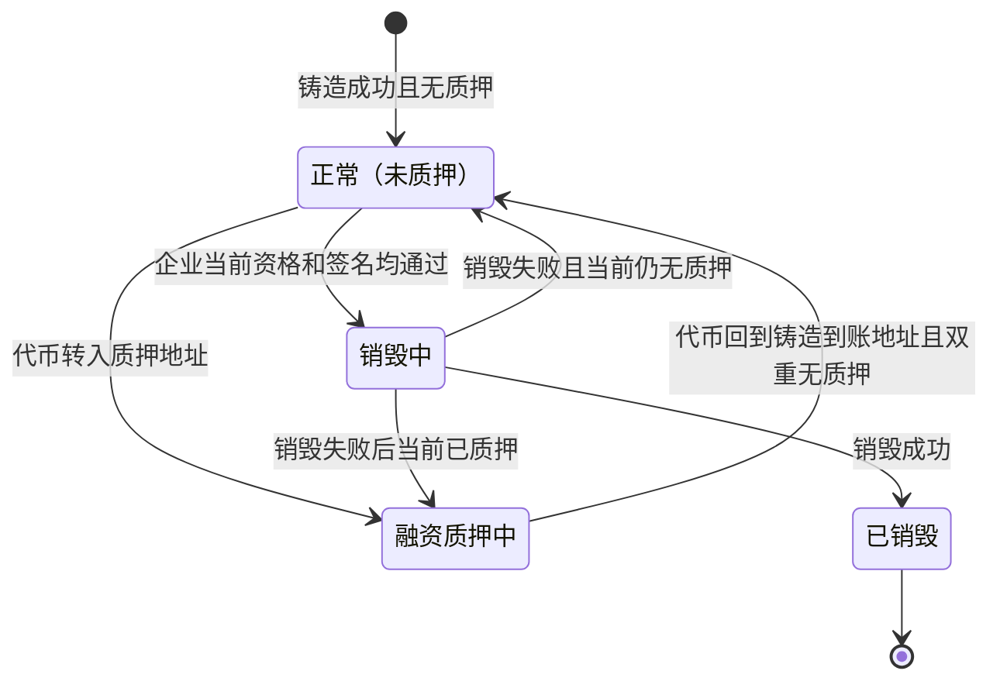
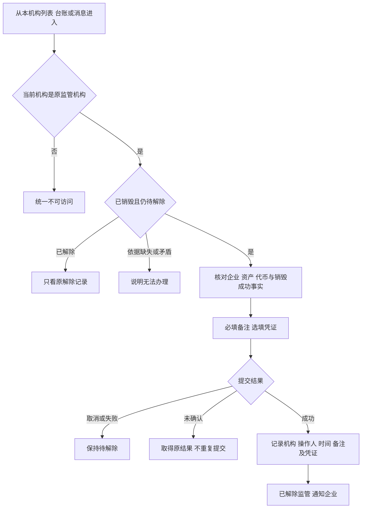
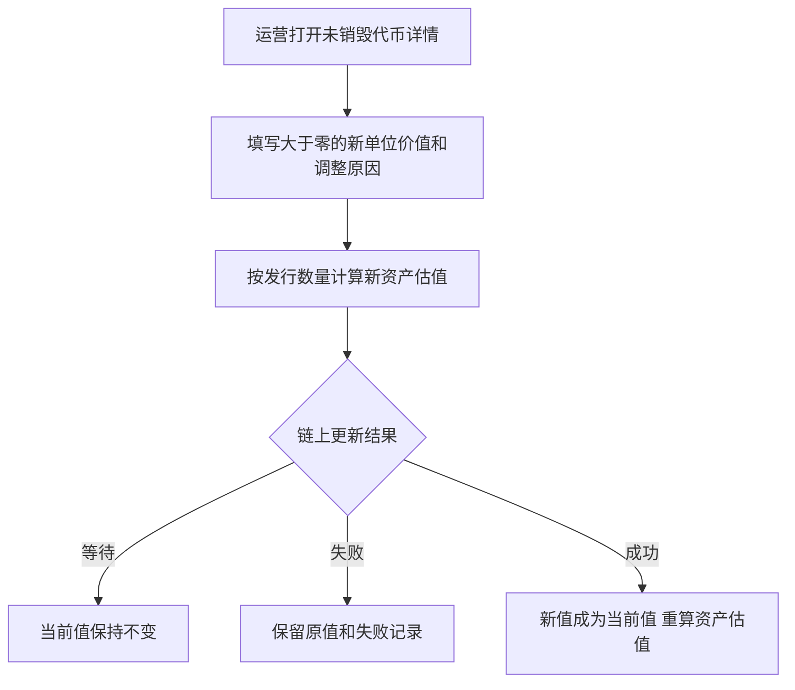

# 销毁执行、解除监管与代币台账 · 流程图与状态机

2026-11-06｜需求评审稿

本册表达业务环节和对象阶段，规则以[01 功能与业务规则](./01-销毁审核与解除质押-PRD.md)为准。节点不代表页面或组件。

| 图 | 内容 | 对应规则 |
| --- | --- | --- |
| [直接执行销毁（图 1）](#fig-1) | 企业提交、平台签名、结果与通知 | [A-BURN-03](./01-销毁审核与解除质押-PRD.md#A-BURN-03) |
| [销毁申请状态（图 2）](#fig-2) | 单笔申请从销毁中到失败或解除完成 | [对象与状态对应](./01-销毁审核与解除质押-PRD.md#states) |
| [代币及监管承接（图 3）](#fig-3) | 代币当前持有与监管独立 | [代币字段](./01-销毁审核与解除质押-PRD.md#handoff-token) |
| [原监管机构解除监管（图 4）](#fig-4) | 核对、提交与留记录 | [R-RELEASE-03](./01-销毁审核与解除质押-PRD.md#R-RELEASE-03) |
| [代币单位价值调整（图 5）](#fig-5) | 链上生效与失败保留原值 | [A-TOKEN-02](./01-销毁审核与解除质押-PRD.md#A-TOKEN-02) |

## 直接执行销毁（图 1）

运营只收到知会并只读查看记录，不出现审核、驳回或手动重试节点。新申请是新业务事实，不把原失败申请恢复为销毁中。

## 销毁申请状态（图 2）

失败申请不再迁回销毁中；企业后续新申请从新的销毁中开始。销毁成功与解除监管是先后两个事实，成功不等于已解除。

## 代币及监管承接（图 3）

代币转让或质押在外时不能发起销毁。销毁失败后代币按当前链上持有与融资事实展示，不伪造回到原地址。监管从铸造成功开始，只有原监管机构提交解除成功才结束。

## 原监管机构解除监管（图 4）

## 代币单位价值调整（图 5）

调价只改变当前单位价值和由其计算的当前资产估值，不改发行数量、应收账款原值、持有、融资、销毁或监管状态。
