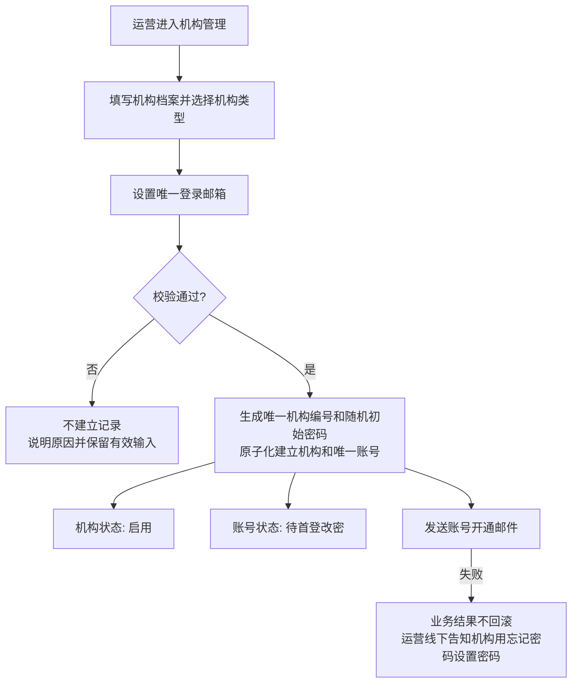
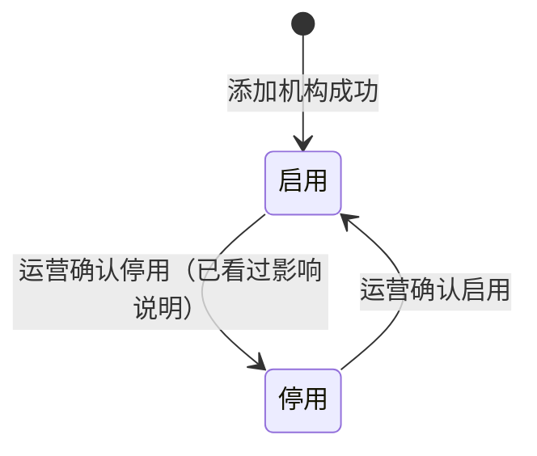
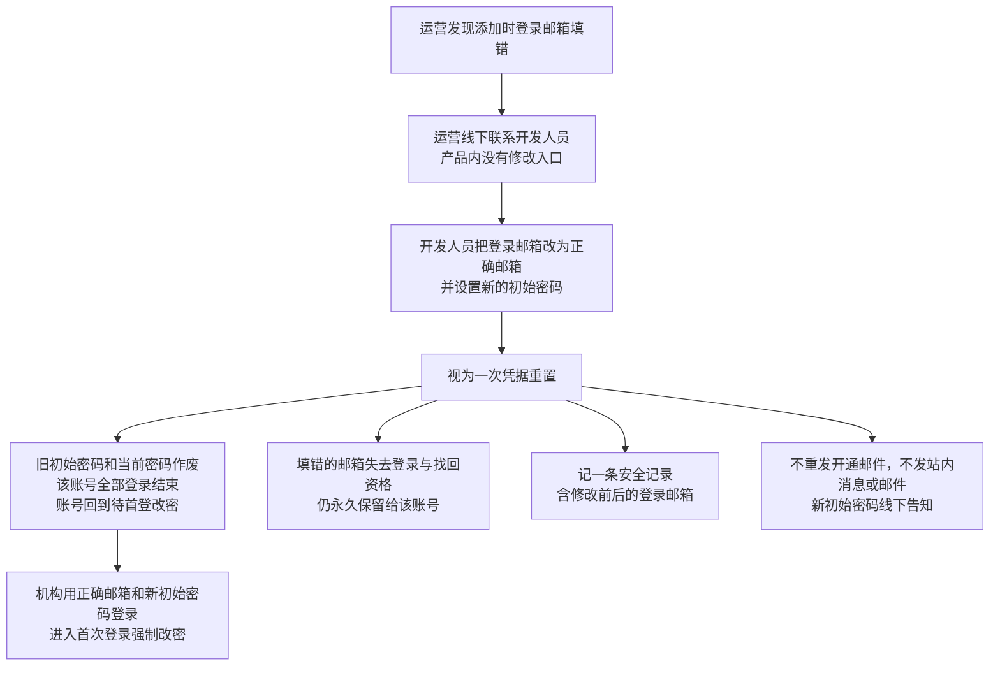

# 机构管理 · 流程图与状态机

2026-11-10｜对应功能册：[01](./01-机构管理-PRD.md)

本册把[功能与业务规则](./01-机构管理-PRD.md)中的主要流程与状态画成图，规则以功能册为准。

| 图 | 内容 | 对应功能 |
| --- | --- | --- |
| [图 1](#fig-1) | 添加机构、开通唯一账号并发送开通邮件 | [添加机构并开通账号（F-RG-02）](./01-机构管理-PRD.md#F-RG-02) |
| [图 2](#state-1) | 机构在启用与停用之间的变化 | [停用与启用（F-RG-05）](./01-机构管理-PRD.md#F-RG-05) |
| [图 3](#fig-3) | 登录邮箱填错时由开发人员更正邮箱并重置凭据 | [登录邮箱填错的纠正](./01-机构管理-PRD.md#login-email-fix) |

## 添加机构并开通账号（图 1）

## 停用与启用（图 2）

- 启用机构可进入新业务的机构选择范围；停用机构不出现在可选范围中。
- 停用不解除已建立的业务关系；启停不改变账号状态和历史数据。既有业务的具体结果由所属业务模块定义，不进入本模块状态机。

## 登录邮箱填错的纠正（图 3）

- 机构编号、机构档案、机构状态和业务归属不变。账号状态的变化见[管理端账号状态机](../M5-管理端登录与权限/02-管理端登录与权限-流程图与状态机.md#state-1)。
