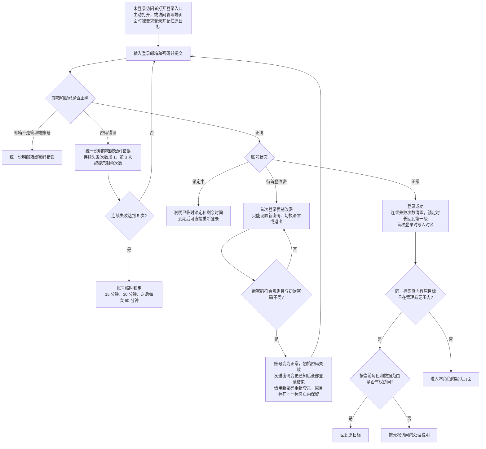
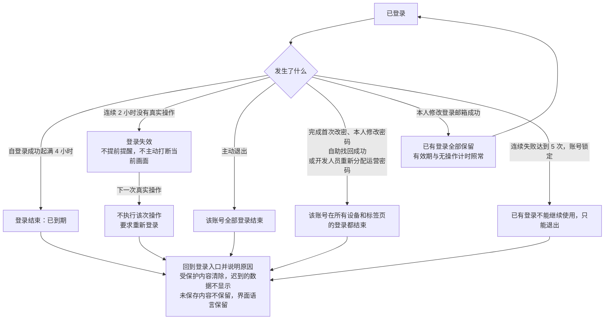
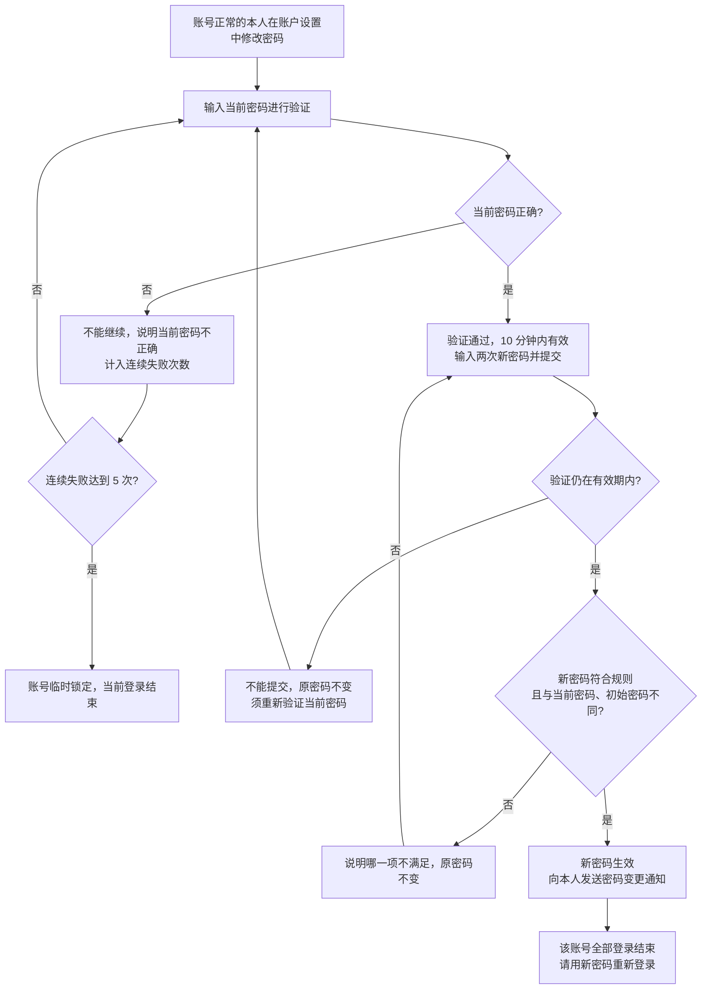
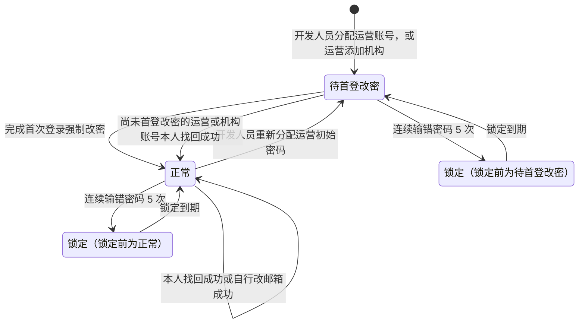
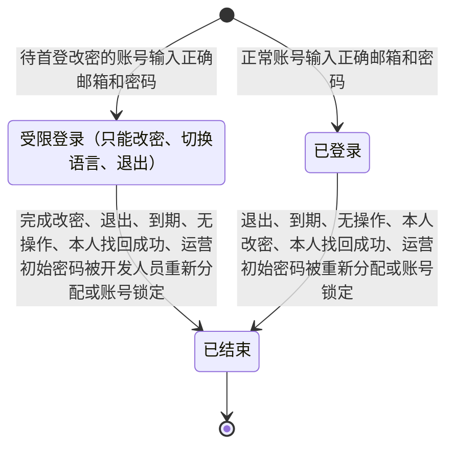
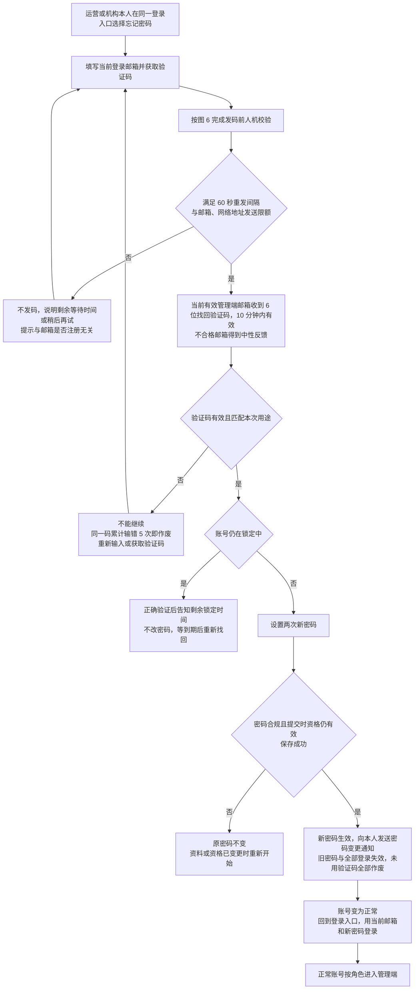
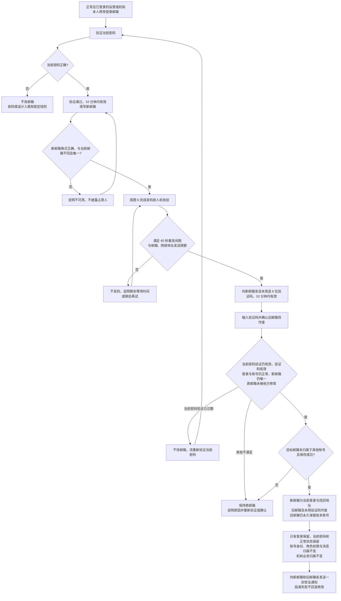
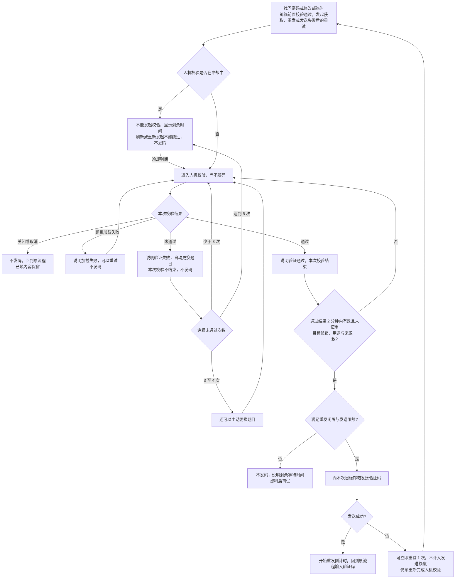
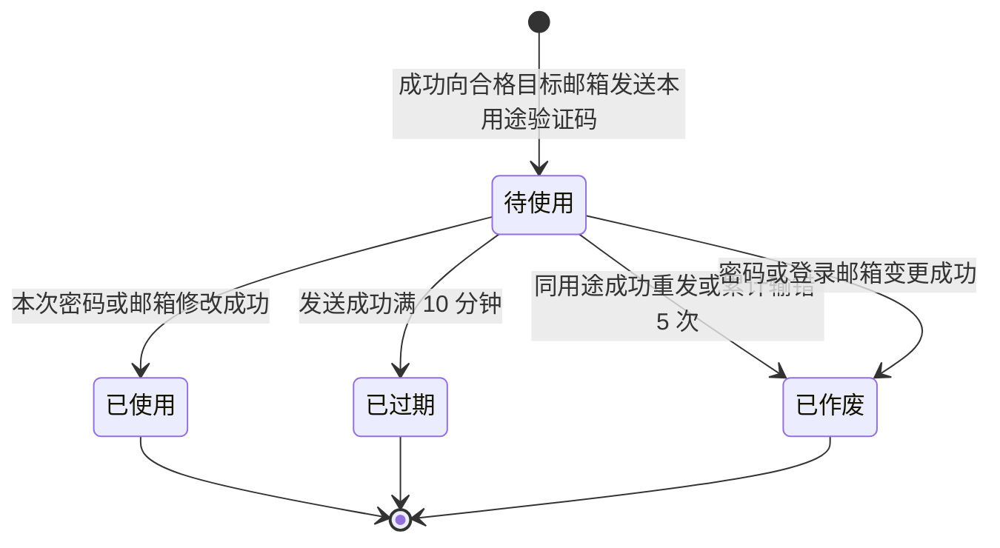

# 管理端登录与权限 · 流程图与状态机

2026-11-06｜需求评审稿

本册把[功能与业务规则](./01-管理端登录与权限-PRD.md)中的主要流程与状态画成图，规则以功能册为准。图中方框是业务环节，不代表页面或组件。

| 图 | 内容 | 对应功能 |
| --- | --- | --- |
| [图 1](#fig-1) | 邮箱与密码登录、锁定判断、首次登录强制改密，以及登录后进入或返回原目标 | [邮箱与密码登录（F-LG-02）](./01-管理端登录与权限-PRD.md#F-LG-02)、[首次登录强制改密（F-LG-03）](./01-管理端登录与权限-PRD.md#F-LG-03)、[登录后进入与返回原目标（F-LG-04）](./01-管理端登录与权限-PRD.md#F-LG-04)、[连续失败与临时锁定（F-LG-05）](./01-管理端登录与权限-PRD.md#F-LG-05) |
| [图 2](#fig-2) | 登录有效期、无操作登出、主动退出与全部登录结束 | [登录有效期、无操作登出与退出（F-LG-06）](./01-管理端登录与权限-PRD.md#F-LG-06) |
| [图 3](#fig-3) | 本人先验证当前密码再修改密码，成功后发送密码变更通知 | [修改密码（F-LG-08）](./01-管理端登录与权限-PRD.md#F-LG-08) |
| [图 4](#fig-4) | 运营与机构共用的邮箱验证码找回密码 | [自助找回密码（F-LG-13）](./01-管理端登录与权限-PRD.md#F-LG-13) |
| [图 5](#fig-5) | 本人验证新邮箱并使旧邮箱作废，已有登录保留，向新旧邮箱发送安全通知 | [本人修改登录邮箱（F-LG-14）](./01-管理端登录与权限-PRD.md#F-LG-14) |
| [图 6](#fig-6) | 找回密码与修改邮箱共用的发码前人机校验 | [发码前人机校验](./01-管理端登录与权限-PRD.md#captcha) |
| [验证码状态机](#state-3) | 找回与改邮箱的验证码从发送到失效 | [验证码的共同规则](./01-管理端登录与权限-PRD.md#verification-rules) |
| [管理端账号状态机](#state-1) | 管理端账号在待首登改密、正常、锁定之间的变化 | [账号状态](./01-管理端登录与权限-PRD.md#account-status) |
| [登录状态机](#state-2) | 一次登录从建立到结束 | [登录有效期、无操作登出与退出（F-LG-06）](./01-管理端登录与权限-PRD.md#F-LG-06) |

## 登录与首次改密（图 1）

## 登录有效期、无操作登出与退出（图 2）

## 修改密码（图 3）

## 管理端账号状态机

- 两类账号初始状态均为待首登改密；本人找回成功即完成首次密码设置并变为正常，不再重复强制改密。本人找回与修改邮箱不改变角色或所属机构。本人改邮箱后仍是同一账号；旧邮箱作废，不再参与登录与找回，但永久保留给本账号，不得分配给其他账号，已有登录保留。
- 锁定只是临时状态，到期自动回到锁定前的状态；锁定中本人不能完成找回。机构添加后运营不能修改其登录邮箱，产品内账号的登录邮箱只能由本人修改；添加时填错的，由运营线下联系开发人员调整。
- 机构的启用 / 停用是机构的状态，不在本状态机中，见[机构状态机](../M5-机构管理/02-机构管理-流程图与状态机.md#state-1)；停用不改变账号状态，账号仍可登录。

## 登录状态机

- 一次登录有效期为 4 小时，连续 2 小时没有真实操作后失效；两者先到先结束。无操作失效不提前提醒，用户下一次真实操作时才要求重新登录，该次操作不执行。
- 受限登录完成改密后直接结束，不会转为已登录；须用新密码重新登录，建立一次新的登录。
- 已结束是终态，不能恢复；之后迟到的操作结果不能让它恢复。
- 本人修改登录邮箱成功不结束已有登录。

## 管理端找回密码（图 4）

## 本人修改登录邮箱（图 5）

## 发码前人机校验（图 6）

- 人机校验的失败与冷却不计入密码连续失败次数，也不计入验证码错误次数；校验与限制提示对任何邮箱都相同。

## 验证码状态机

- 验证码按账号、用途与目标邮箱分别有效；更换目标后不能把原目标的码用于新邮箱。
- 已使用、已过期与已作废均为终态；发送失败不产生可用验证码。位数、有效期、错误上限与发送限制见[验证码参数](./01-管理端登录与权限-PRD.md#code-params)。
