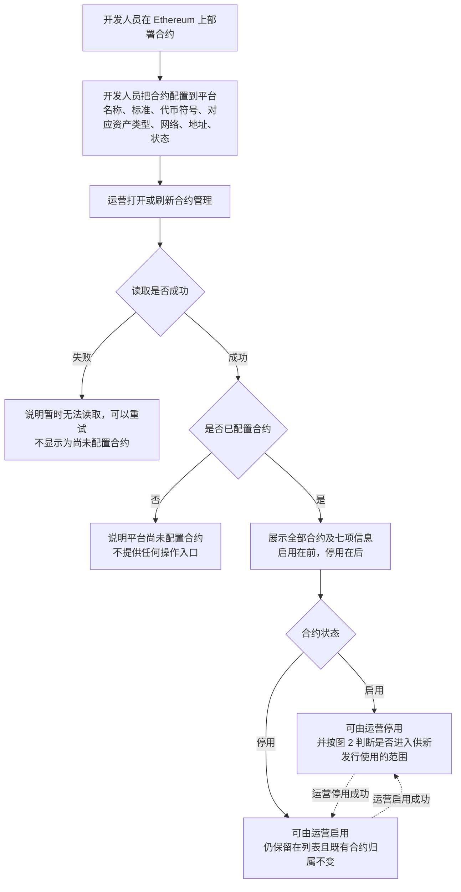
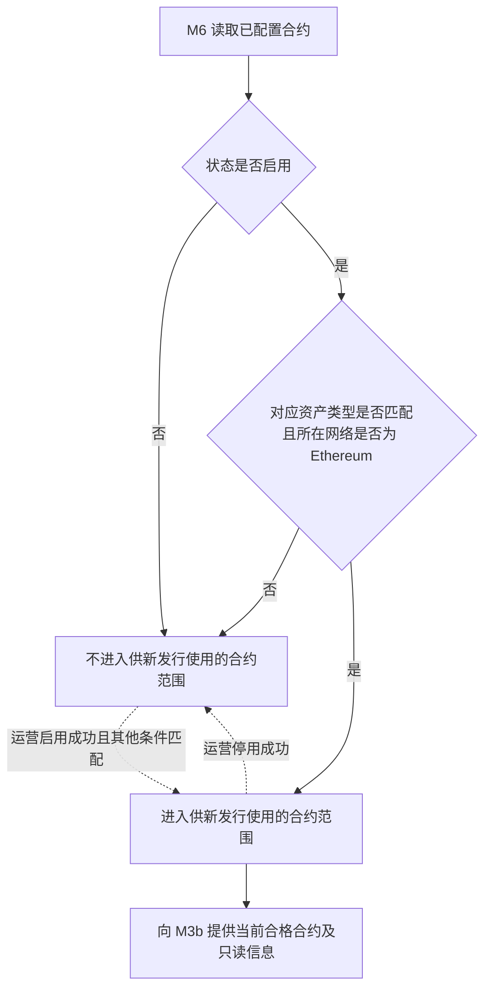
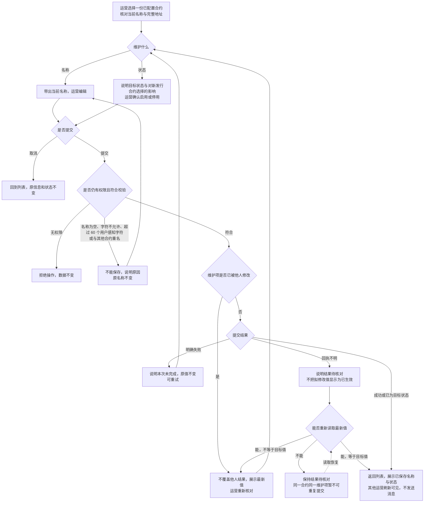
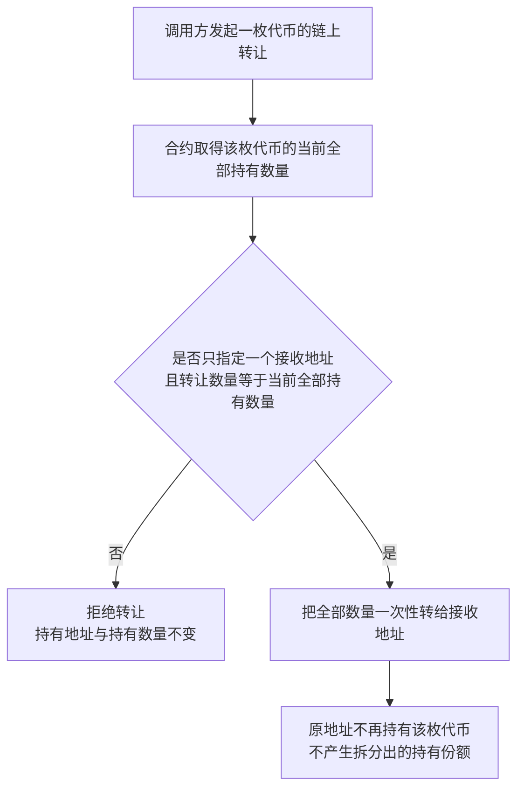
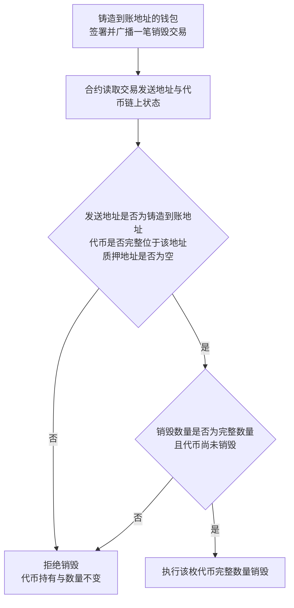
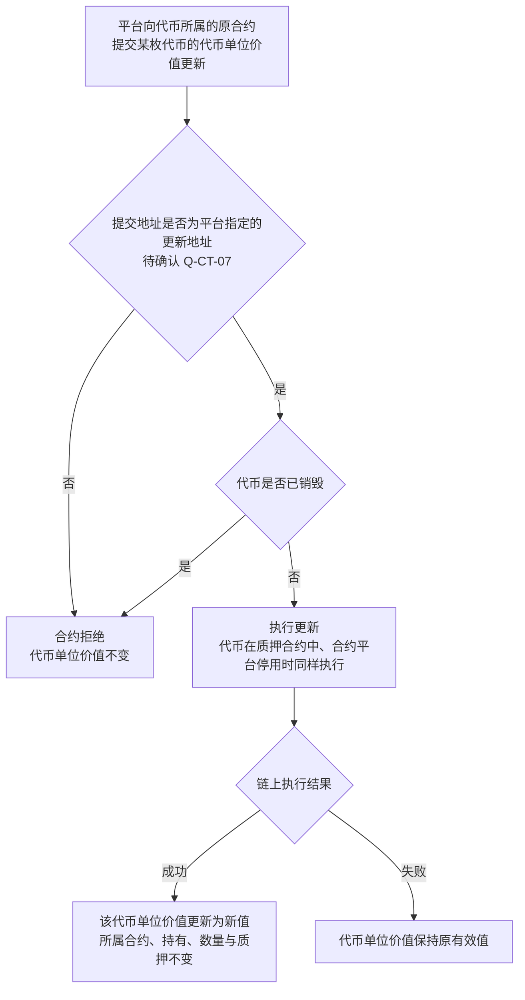
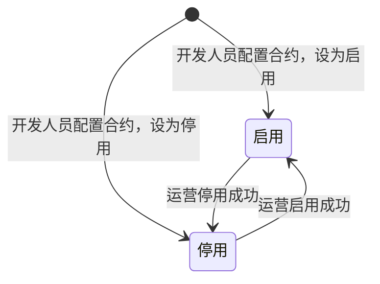

# 合约管理 · 流程图与状态机

2026-11-10｜需求评审稿

本册把[功能与业务规则](./01-合约管理-PRD.md)中的主要流程与状态画成图，规则以功能册为准。图中方框是业务环节，不代表页面或组件。

| 图 | 内容 | 对应功能 |
| --- | --- | --- |
| [图 1](#fig-1) | 开发人员配置合约，运营在合约列表中查看和维护平台状态 | [合约列表（F-CT-01）](./01-合约管理-PRD.md#F-CT-01) |
| [图 2](#fig-2) | M6 按状态、资产类型与所在网络提供供新发行使用的合约范围 | [供新发行使用的合约资格（F-CT-02）](./01-合约管理-PRD.md#F-CT-02) |
| [图 3](#fig-3) | 运营编辑名称、启用与停用，以及取消、校验失败、明确失败、回执不明与冲突的去向 | [编辑合约名称（F-CT-03）](./01-合约管理-PRD.md#F-CT-03)、[启用与停用合约（F-CT-04）](./01-合约管理-PRD.md#F-CT-04) |
| [图 4](#fig-4) | 合约按当前全部持有数量校验转让，拒绝部分转让与拆分 | [完整转让限制（F-CT-05）](./01-合约管理-PRD.md#F-CT-05) |
| [图 5](#fig-5) | 合约验证销毁交易发送地址与链上硬约束，拒绝其他地址发起 | [销毁发起地址限制（F-CT-06）](./01-合约管理-PRD.md#F-CT-06) |
| [图 6](#fig-6) | 平台向代币所属的原合约提交代币单位价值更新，以及合约拒绝更新的情形 | [代币单位价值链上更新（F-CT-07）](./01-合约管理-PRD.md#F-CT-07) |
| [合约状态机](#state-1) | 合约状态在启用与停用之间的变化 | [合约状态](./01-合约管理-PRD.md#status) |

发行申请、销毁申请、代币单位价值调整、融资和失败重试的办理流程由 M3b、M4a、M4b 及下游借贷业务各自画出，本册不重复。

## 合约配置、查看与平台状态（图 1）

## 供新发行使用的合约资格变化（图 2）

M6 只提供资格范围，不画 M3b 的选择、提交、无合约处理或铸造重试。合约退出范围后不改写既有归属，见[停用与既有归属](./01-合约管理-PRD.md#inflight)。

## 维护合约名称与状态（图 3）

名称校验规则见[合约名称](./01-合约管理-PRD.md#name-rules)。启用与停用不自动发起其他模块的业务。

## 完整转让的合约校验（图 4）

任何调用方与直接调用合约都受同一规则约束；接收方是普通地址或合约地址不改变校验。融资、批量办理和释放条件由下游借贷业务定义，不在本图展开；授权、铸造、销毁和代币单位价值调整不属于本图的转让。

## 销毁发起地址的合约校验（图 5）

一笔由铸造到账地址发送的交易即可完成销毁，不需要平台代发或另签授权交易。当前登录地址、后续受让地址、平台地址或其他地址都不能替代铸造到账地址；每笔新交易都重新执行同一校验。到期、结清和下游融资结果只用于平台入口准入，不在合约校验中判断。

## 代币单位价值链上更新（图 6）

更新始终提交到代币所属的原合约；合约平台状态不影响更新。发起入口、可调整条件、新值校验、调整记录和结果展示见 M4b 的[调整代币单位价值（A-TOKEN-02）](../M4b-销毁审核与解除质押/01-销毁审核与解除质押-PRD.md#A-TOKEN-02)。提交地址限制待[链上更新的提交地址（Q-CT-07）](./01-合约管理-PRD.md#Q-CT-07)确认。

## 合约状态机

- 初始状态由开发人员配置时设定；运营可在两种状态间来回调整。
- 取消或明确失败时状态不变；回执不明时重新读取最新状态，读取前不推定状态是否变化；并发冲突展示最新状态，不覆盖他人结果；已为目标状态时不再转换。
- 合约不从平台移除，没有终态；不再使用的合约保持停用。
- 状态变化不发送任何消息；停用使合约退出供新发行使用的范围，但不改变原合约及既有业务归属，见[停用与既有归属](./01-合约管理-PRD.md#inflight)。
- 平台状态变化不自动发起发行、销毁或重试，也不代表链上异常已经恢复。
