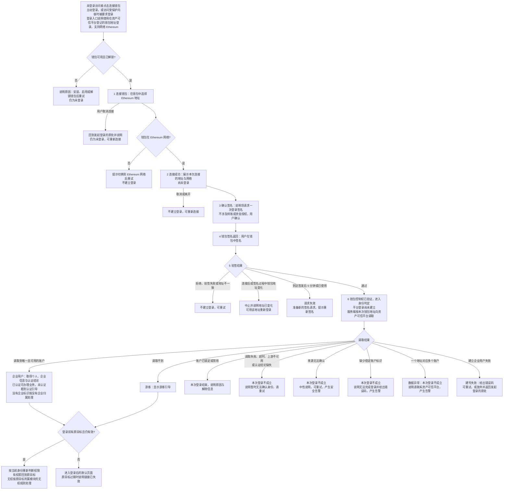
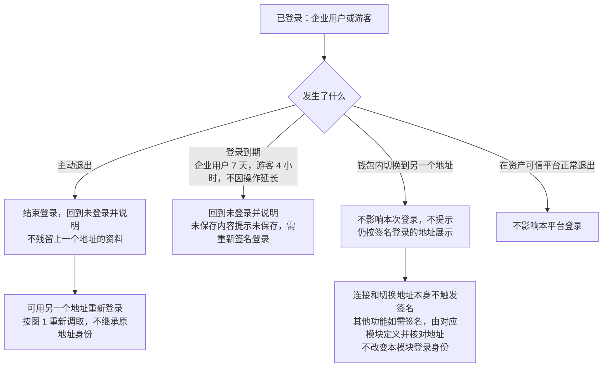
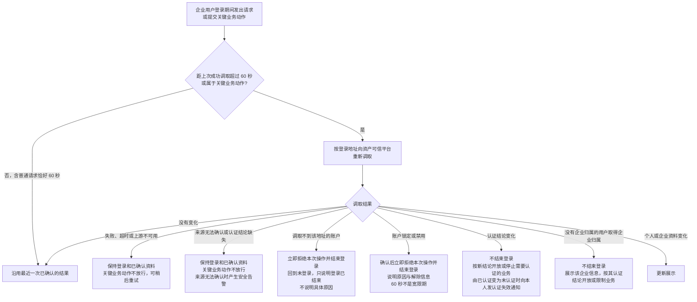
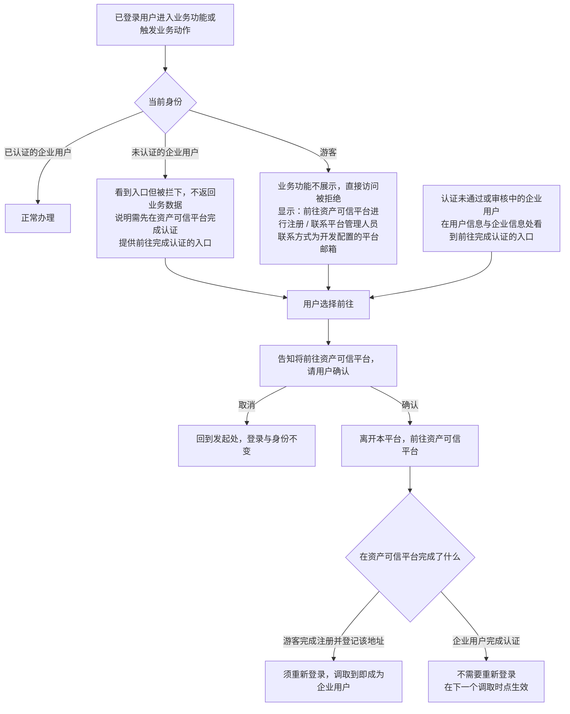
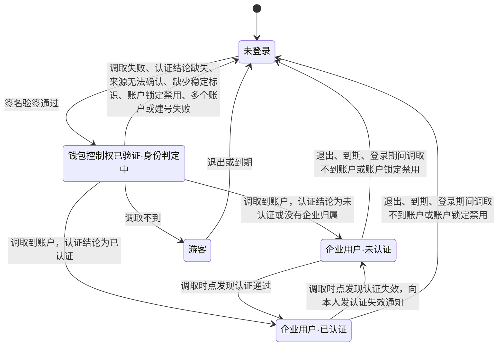

# 企业登录与企业账户 · 流程图与状态机

2026-11-09｜需求评审稿

本册把[功能与业务规则](./01-企业登录与企业账户-PRD.md)中的主要流程与状态画成图，规则以功能册为准。图中方框是业务环节，不代表页面或组件。

| 图 | 内容 | 对应功能 |
| --- | --- | --- |
| [图 1](#fig-1) | 连接钱包、签名登录、按地址调取上游并成为企业用户或游客，再返回原目标 | [连接钱包与签名登录（C-AUTH-01）](./01-企业登录与企业账户-PRD.md#C-AUTH-01)、[按地址匹配上游身份（C-AUTH-02）](./01-企业登录与企业账户-PRD.md#C-AUTH-02)、[登录后返回原目标（C-AUTH-05）](./01-企业登录与企业账户-PRD.md#C-AUTH-05) |
| [图 2](#fig-2) | 主动退出、换地址、登录后钱包切换地址与登录到期 | [退出与切换钱包（C-AUTH-03）](./01-企业登录与企业账户-PRD.md#C-AUTH-03) |
| [图 5](#fig-5) | 登录期间的调取时点，以及调取不到账户、账户锁定或禁用、认证结论变化、取得企业归属和资料变化后的处理 | [上游变化的同步（C-AUTH-06）](./01-企业登录与企业账户-PRD.md#C-AUTH-06) |
| [图 6](#fig-6) | 游客与未认证企业用户被拦下后的引导、用户信息处的前往完成认证，以及前往资产可信平台的确认 | [认证资格与受限引导（C-AUTH-04）](./01-企业登录与企业账户-PRD.md#C-AUTH-04)、[游客引导与功能限制（C-GUEST-01）](./01-企业登录与企业账户-PRD.md#C-GUEST-01)、[查看用户信息与企业信息（C-PROFILE-01）](./01-企业登录与企业账户-PRD.md#C-PROFILE-01) |
| [面客端登录状态机](#state-1) | 访问者从未登录到企业用户或游客，再到退出 | [按地址匹配上游身份（C-AUTH-02）](./01-企业登录与企业账户-PRD.md#C-AUTH-02)、[认证资格与受限引导（C-AUTH-04）](./01-企业登录与企业账户-PRD.md#C-AUTH-04)、[退出与切换钱包（C-AUTH-03）](./01-企业登录与企业账户-PRD.md#C-AUTH-03) |

## 登录与身份判定（图 1）

## 退出、切换钱包与登录到期（图 2）

## 上游变化的同步（图 5）

## 受限引导与前往资产可信平台（图 6）

## 面客端登录状态机

- 初始状态是未登录；没有终态，退出后可再次登录。
- 企业用户·未认证包含没有企业归属的情形；没有企业归属的用户取得企业归属后，按该企业的认证结论留在未认证或经“调取时点发现认证通过”进入已认证。企业归属取得后不再变化。
- 企业用户的有效期为 7 天，游客为 4 小时，分别自进入企业用户或游客状态时起计算，不因操作延长；认证状态在已认证与未认证之间变化时不重新计算有效期。
- 游客与企业用户之间不直接转换：游客在上游完成注册并登记该地址后，须退出并重新登录，经过一次签名与调取才成为企业用户。
