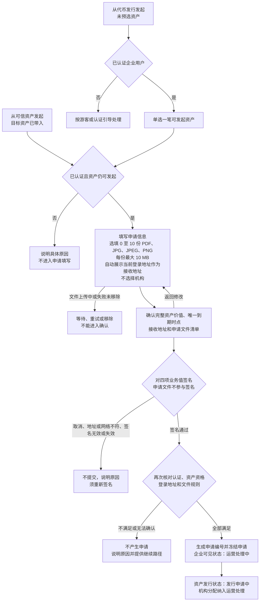
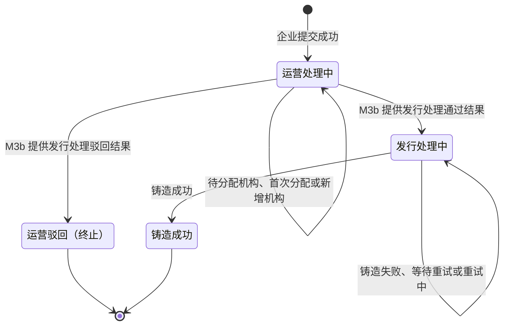
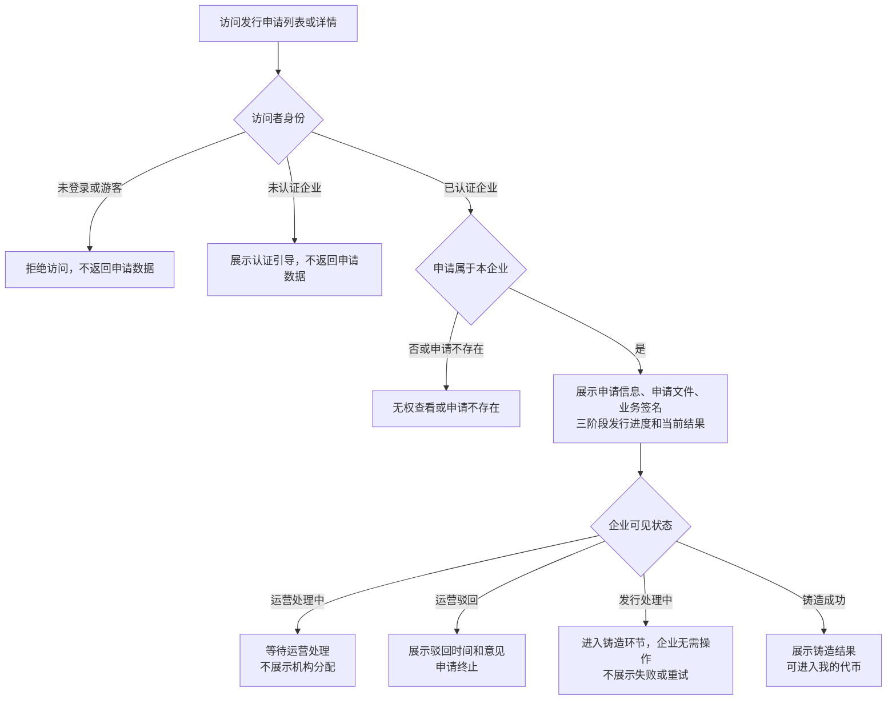

# 代币发行 · 企业申请 · 流程图与状态机

2026-11-09｜需求评审稿

本册把[功能与业务规则](./01-代币发行-企业申请-PRD.md)中的主要流程和企业可见进度画成图。方框表示业务环节，不代表页面或组件。

| 图 | 内容 | 对应功能 |
| --- | --- | --- |
| [发起并提交发行申请（图 1）](#fig-1) | 企业确定资产、选填文件、核对自动接收地址并签名提交；不选择机构 | [发起申请与确定资产（C-ISSUE-01）](./01-代币发行-企业申请-PRD.md#C-ISSUE-01)、[上传发行申请文件（C-ISSUE-08）](./01-代币发行-企业申请-PRD.md#C-ISSUE-08)、[确认并提交申请（C-ISSUE-04）](./01-代币发行-企业申请-PRD.md#C-ISSUE-04) |
| [企业可见处理进度（图 2）](#fig-2) | 企业提交后进入运营处理，机构分配包含在运营处理内，处理通过后进入铸造 | [企业可见状态与进度](./01-代币发行-企业申请-PRD.md#status) |
| [查看申请详情（图 3）](#fig-3) | 按身份、归属和状态展示申请结果 | [申请详情（C-ISSUE-06）](./01-代币发行-企业申请-PRD.md#C-ISSUE-06) |

## 发起并提交发行申请（图 1）

## 企业可见处理进度（图 2）

企业只看到“企业提交、运营处理、铸造”三个环节。机构分配是运营处理的内部环节，不触发企业进度变化。图中转换条件是 M3b 提供给本模块的处理事实；管理端操作条件和真实状态由 M3b 定义。

- 申请流程和申请详情不展示机构分配环节、分配机构名称、数量、类型和变更历史；铸造成功后的机构材料在我的代币中查看。
- 首次分配或后续新增机构时，企业进度始终停留在“运营处理”，不前进也不回退。
- “发行处理中”是企业侧统一展示，不暴露内部失败及重试节点。

## 查看申请详情（图 3）

