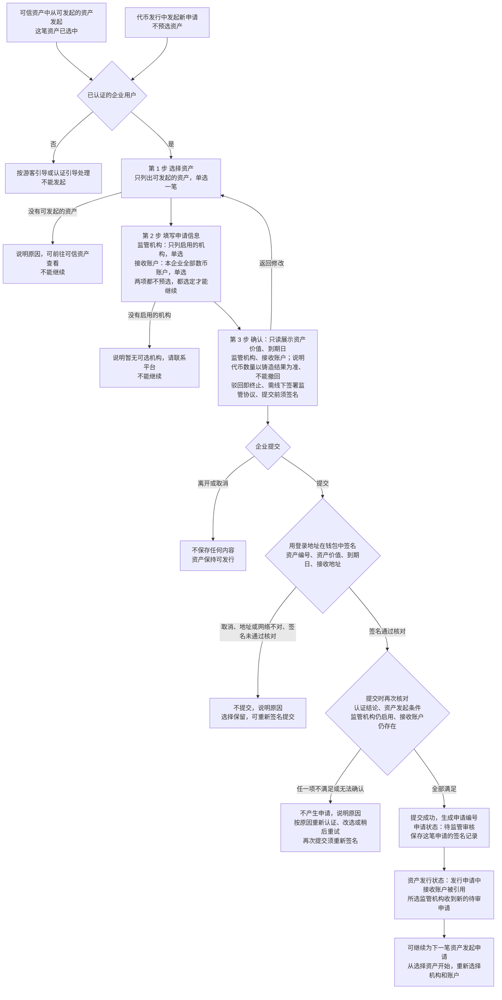
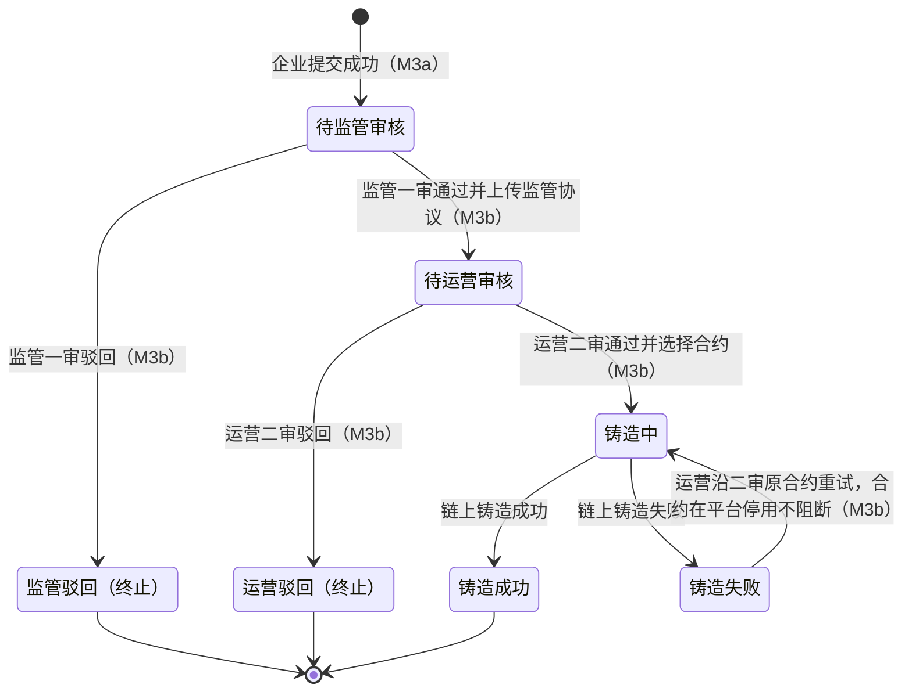
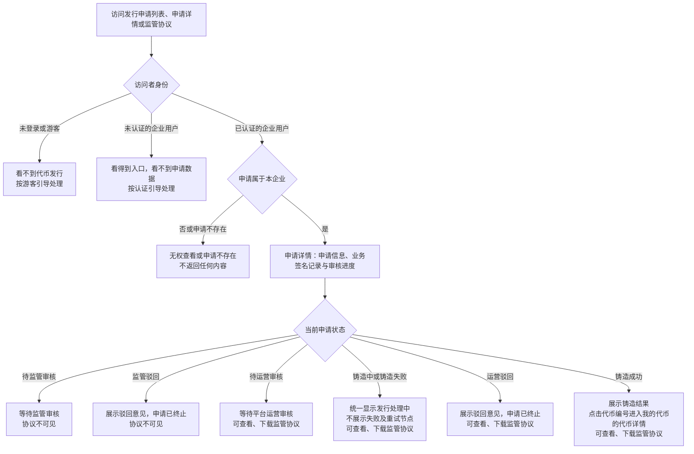

# 代币发行 · 企业申请 · 流程图与状态机

2026-11-05｜需求评审稿

本册把[功能与业务规则](./01-代币发行-企业申请-PRD.md)中的主要流程与申请状态画成图，规则以功能册为准。图中方框是业务环节或业务状态，不代表页面或组件。

| 图 | 内容 | 对应功能 |
| --- | --- | --- |
| [发起并提交发行申请（图 1）](#fig-1) | 从两个入口发起，经选择资产、填写申请信息（监管机构与接收账户）和确认三步，签名后提交成功或不成功 | [发起申请与选择资产（C-ISSUE-01）](./01-代币发行-企业申请-PRD.md#C-ISSUE-01)、[选择监管机构（C-ISSUE-02）](./01-代币发行-企业申请-PRD.md#C-ISSUE-02)、[选择接收账户（C-ISSUE-03）](./01-代币发行-企业申请-PRD.md#C-ISSUE-03)、[确认并提交申请（C-ISSUE-04）](./01-代币发行-企业申请-PRD.md#C-ISSUE-04) |
| [发行申请状态（图 2）](#fig-2) | 简报第 5 节的申请状态及推动环节 | [申请状态与企业看到的内容](./01-代币发行-企业申请-PRD.md#status) |
| [查看申请与监管协议（图 3）](#fig-3) | 访问申请详情和监管协议时的身份、归属与状态判断 | [申请详情（C-ISSUE-06）](./01-代币发行-企业申请-PRD.md#C-ISSUE-06)、[查看与下载监管协议（C-ISSUE-07）](./01-代币发行-企业申请-PRD.md#C-ISSUE-07) |

## 发起并提交发行申请（图 1）

## 发行申请状态（图 2）

状态引用简报第 5 节，本模块不另行定义。初始状态为“待监管审核”；“监管驳回”“运营驳回”“铸造成功”是终态。除提交外，所有转换都由代币发行·审核与铸造（M3b）推动，企业不能改变状态。

下图画真实业务状态。企业侧把“铸造中”“铸造失败”统一显示为“发行处理中”，不展示失败及重试节点；运营端保留真实状态，见[申请状态与企业看到的内容](./01-代币发行-企业申请-PRD.md#status)。

申请状态与资产发行状态的对应：待监管审核、待运营审核、铸造中、铸造失败对应“发行申请中”；监管驳回、运营驳回对应“已驳回”；铸造成功对应“已发行”，见[发行状态（图 2）](../../两端共用/M2-可信资产/02-可信资产-流程图与状态机.md#fig-2)。

原合约存在实际链上执行异常或未能发起重试时保持“铸造失败”，合约在平台停用不阻断重试；两种情况企业都看到“发行处理中”；具体操作由[铸造失败手动重试（A-ISSUE-07）](../../管理端/M3b-代币发行-审核与铸造/01-代币发行-审核与铸造-PRD.md#A-ISSUE-07)定义。资产在提交后被撤销确权、删除、逾期或结清，不自动改变申请状态或阻断处理，见[审核期间资产变化](../../管理端/M3b-代币发行-审核与铸造/01-代币发行-审核与铸造-PRD.md#review-asset-change)。

## 查看申请与监管协议（图 3）

