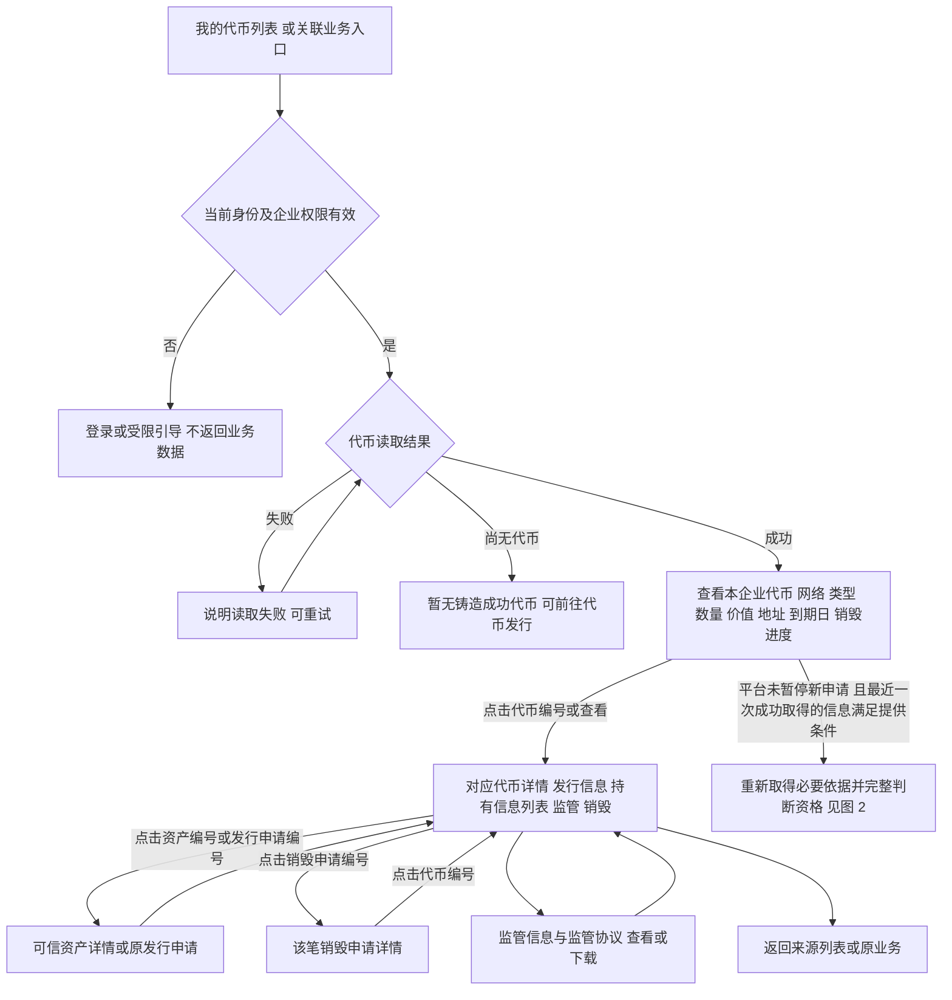
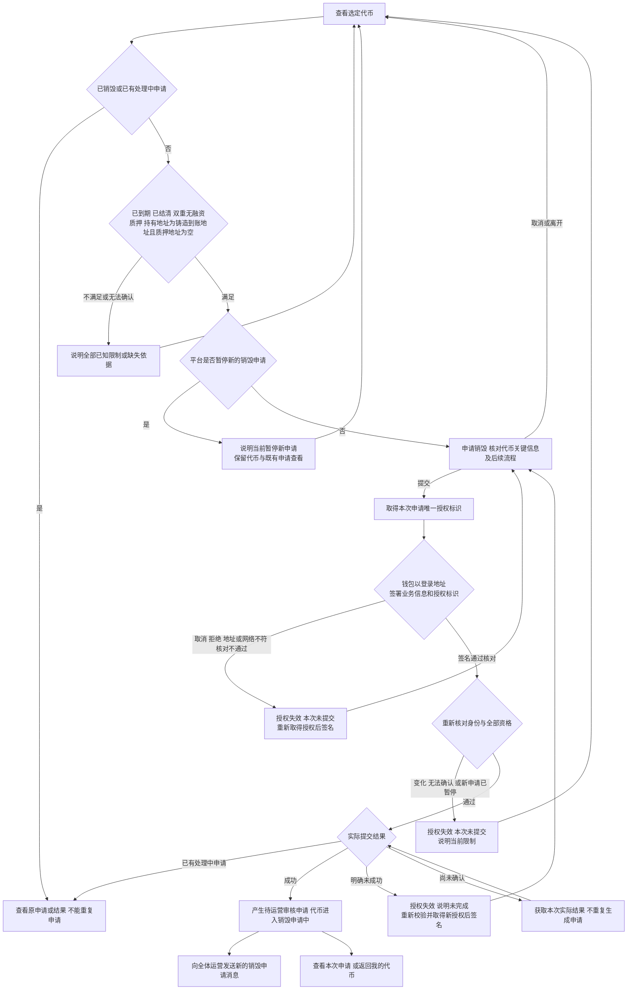
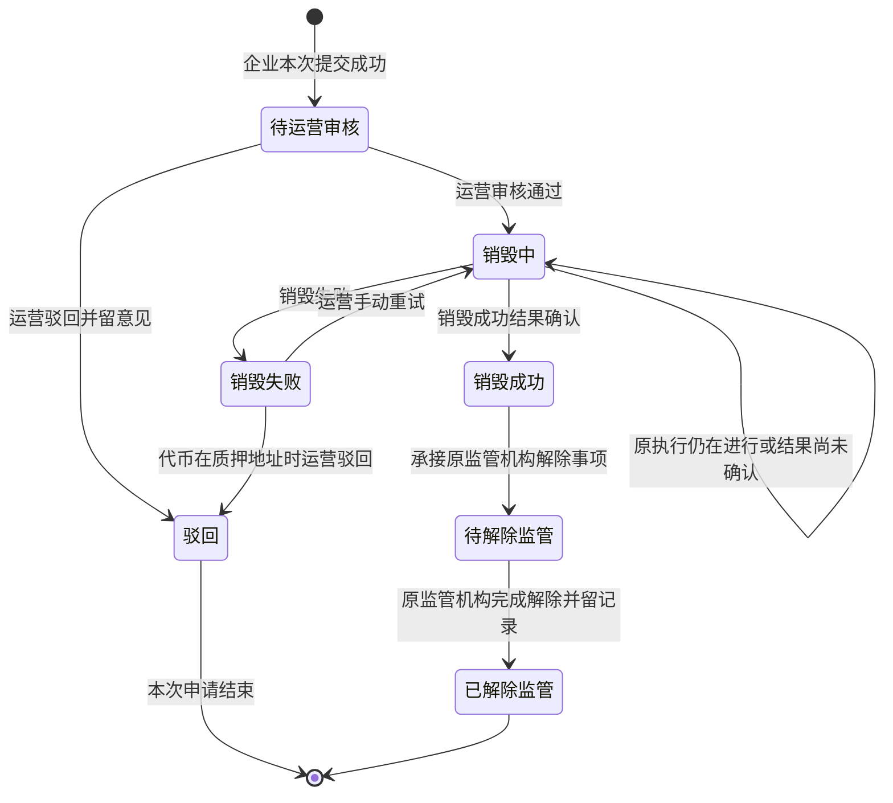
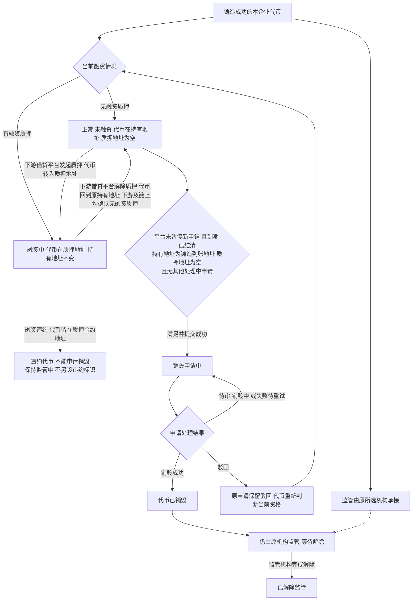

# 我的代币与销毁申请 · 流程图与状态机

2026-11-05｜面客端：企业用户｜需求评审稿

本册画出企业查看、申请销毁、销毁执行与解除监管的业务过程，规则以[01 功能与业务规则](./01-我的代币与销毁申请-PRD.md)为准。节点是业务环节，不代表页面或组件。状态引用简报第 5 节；本平台只有监管，监管相关阶段称为待解除监管、已解除监管，不另建状态。跨端字段和可见范围直接引用 M4b [两端衔接字段清单](../../管理端/M4b-销毁审核与解除质押/01-销毁审核与解除质押-PRD.md#handoff)。

| 图 | 内容 | 对应功能 |
| --- | --- | --- |
| 图 1 | 企业查看代币、关联业务与返回 | [我的代币列表（C-TOKEN-01）](./01-我的代币与销毁申请-PRD.md#C-TOKEN-01)、[代币详情（C-TOKEN-02）](./01-我的代币与销毁申请-PRD.md#C-TOKEN-02) |
| 图 2 | 销毁资格判断、确认、签名与提交结果 | [销毁资格与限制原因（C-TOKEN-03）](./01-我的代币与销毁申请-PRD.md#C-TOKEN-03)、[申请销毁（C-BURN-01）](./01-我的代币与销毁申请-PRD.md#C-BURN-01) |
| 图 3 | 销毁申请状态及解除监管过程 | [申请详情与解除监管进度（C-BURN-03）](./01-我的代币与销毁申请-PRD.md#C-BURN-03)、[驳回后再次申请销毁（C-BURN-04）](./01-我的代币与销毁申请-PRD.md#C-BURN-04) |
| 图 4 | 代币持有、质押融资与监管的独立关系 | [对象与状态](./01-我的代币与销毁申请-PRD.md#states)、[多条件组合](./01-我的代币与销毁申请-PRD.md#C-TOKEN-03) |

## 企业查看与返回（图 1）

列表操作列提供“查看”和按条件提供的“申请销毁”，见[我的代币列表的操作](./01-我的代币与销毁申请-PRD.md#token-actions)；列表操作只是依据最近一次成功取得的信息给出的办理提示，点击后须重新取得必要依据。平台暂停新的销毁申请、依赖信息缺失或无法确认时不提供该操作，但查看既有代币与申请不受影响。前往其他对象一律点击其编号，不另设文字入口，见[通过编号前往详情](./01-我的代币与销毁申请-PRD.md#id-links)。关联对象无权或不存在时，统一说明暂不可访问；读取依赖信息失败不等于代币不存在。字段未知时保留可查内容，资格不放行。

## 校验、签名与提交（图 2）

签名只确认业务信息，签名本身不是链上交易；签名内容为代币、申请销毁数量、持有地址和本次申请授权标识。授权标识只能用于一次成功提交；提交成功后由本申请占用，取消、重新进入、身份或资格变化、暂停新申请、核对不通过或明确提交失败时失效，结果未确认时先取得原结果。签名值与授权标识随销毁交易写入链上，规则见[提交时的业务签名](./01-我的代币与销毁申请-PRD.md#burn-signing)。地址条件以链上持有信息为准，查询失败视为无法确认，见[销毁资格](./01-我的代币与销毁申请-PRD.md#eligibility)。融资两项结果均无质押才满足；任一有质押或两项不一致都不放行，任一未知也不放行。平台停用不阻断既有代币按原条件提交销毁或后续办理，仍使用原合约，见[停用与既有业务](../../管理端/M6-合约管理/01-合约管理-PRD.md#inflight)。

## 销毁申请状态与解除监管（图 3）

- 销毁成功后即使当前进度已进入待解除监管，成功事实仍保留。
- 原执行仍在进行或结果尚未确认时保持销毁中，不自行改成失败；确认失败后等待运营处理仍占用原申请，企业不能重新申请。运营重试沿用原申请编号及原代币事实，不另建申请。
- 企业从驳回记录再次申请销毁时，先重新校验，取得新的本次申请授权标识并重新签名，再创建新申请；原申请仍为驳回。新旧记录用不同申请编号和授权标识关联同一代币；驳回释放占用后按当前融资事实回退，未知时不放行，按 M4b [状态对应](../../管理端/M4b-销毁审核与解除质押/01-销毁审核与解除质押-PRD.md#states)，不在同一状态机把驳回恢复成待审。
- 解除办理未成功或结果尚未确认时，不展示已解除监管，不替 M4b 增加失败终态或重试策略。

## 代币持有、融资与监管的关系（图 4）

一期代币只能由下游借贷平台发起转入、转出质押地址，持有与质押信息从链上查询，见[持有信息列表](./01-我的代币与销毁申请-PRD.md#holding-info)。融资与监管是独立信息；监管中不阻断满足条件的销毁，已销毁不等于监管已经解除。已销毁是代币终态，不能回到可申请。组合展示及未知信息以[功能册的资格组合](./01-我的代币与销毁申请-PRD.md#C-TOKEN-03)为准。
