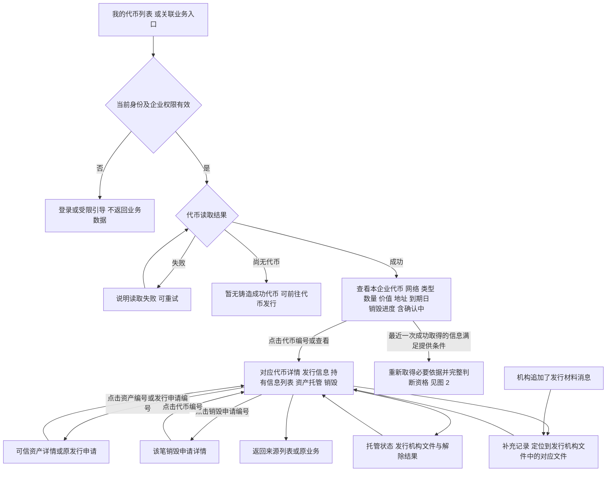
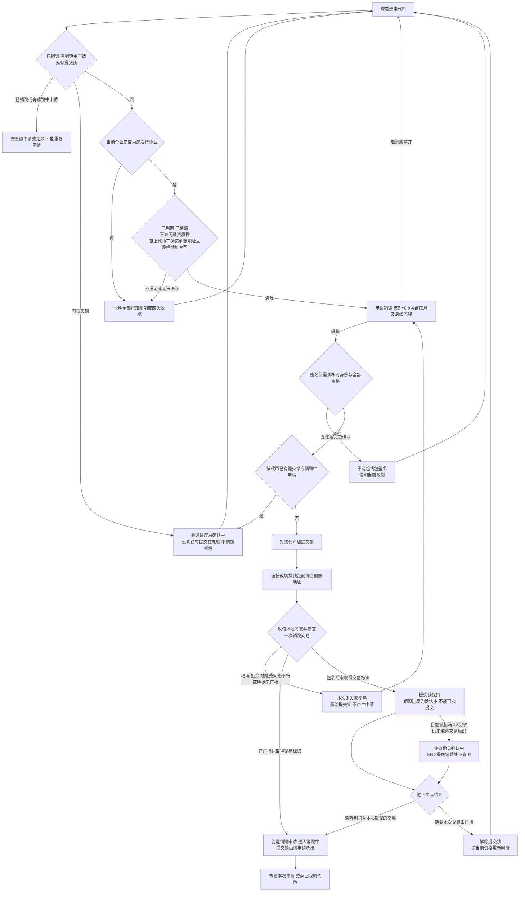
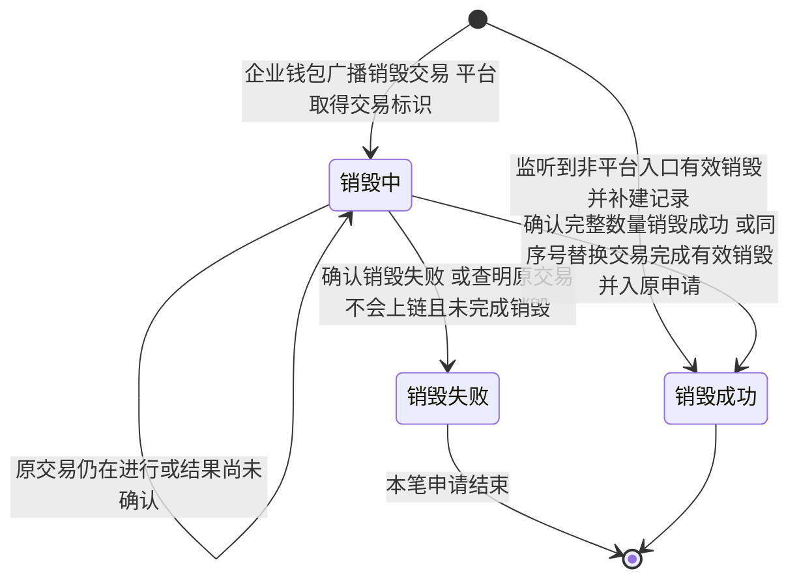
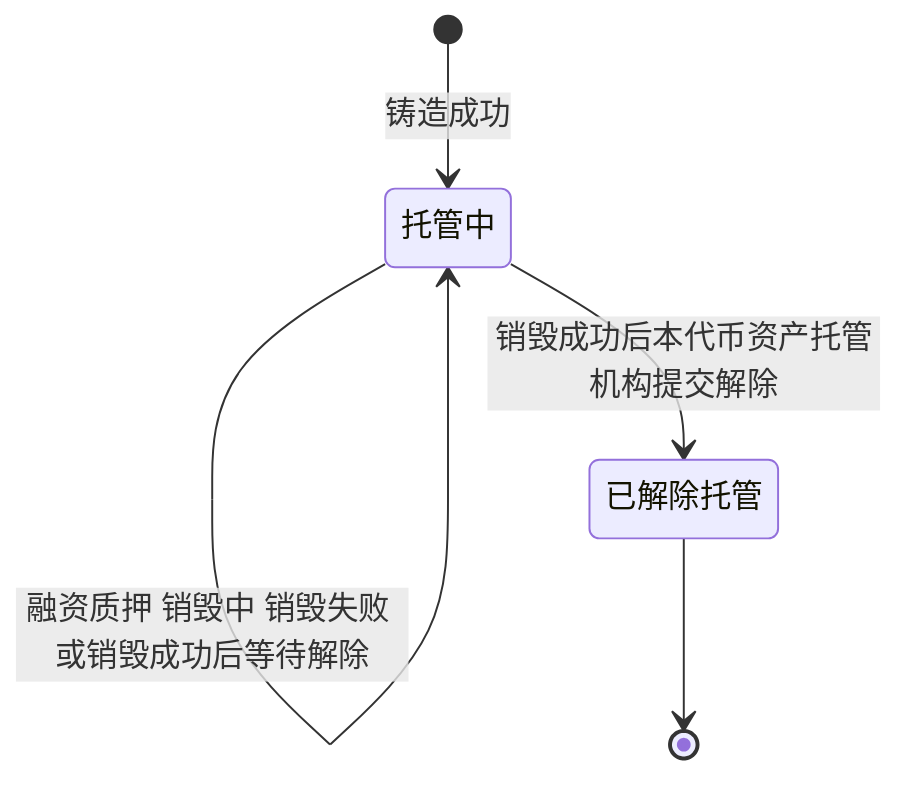
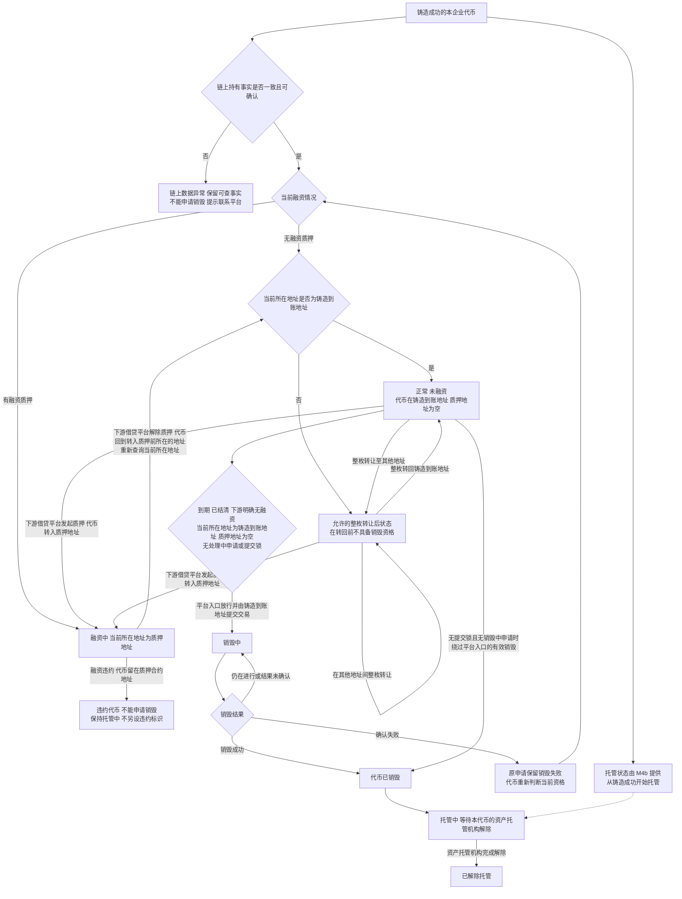

# 我的代币与销毁申请 · 流程图与状态机

2026-11-10｜面客端：企业用户｜需求评审稿

本册画出企业查看、申请销毁、销毁执行与解除资产托管的业务过程，规则以[01 功能与业务规则](./01-我的代币与销毁申请-PRD.md)为准。节点是业务环节，不代表页面或组件。销毁申请状态只有销毁中、销毁失败、销毁成功；资产托管状态只有托管中、已解除托管，与融资质押分开；“待解除托管”是资产托管机构的待办事项，不是状态。跨端字段和可见范围直接引用 M4b [两端衔接字段清单](../../管理端/M4b-销毁审核与解除质押/01-销毁审核与解除质押-PRD.md#handoff)。

| 图 | 内容 | 对应功能 |
| --- | --- | --- |
| 图 1 | 企业查看代币、关联业务与返回 | [我的代币列表（C-TOKEN-01）](./01-我的代币与销毁申请-PRD.md#C-TOKEN-01)、[代币详情（C-TOKEN-02）](./01-我的代币与销毁申请-PRD.md#C-TOKEN-02) |
| 图 2 | 销毁资格判断、提交锁、确认、签名与提交结果 | [销毁资格与限制原因（C-TOKEN-03）](./01-我的代币与销毁申请-PRD.md#C-TOKEN-03)、[申请销毁（C-BURN-01）](./01-我的代币与销毁申请-PRD.md#C-BURN-01) |
| 图 3 | 销毁申请状态与资产托管状态 | [申请详情与资产托管（C-BURN-03）](./01-我的代币与销毁申请-PRD.md#C-BURN-03)、[销毁失败后重新发起（C-BURN-05）](./01-我的代币与销毁申请-PRD.md#C-BURN-05) |
| 图 4 | 代币持有、质押融资与资产托管的独立关系 | [对象与状态](./01-我的代币与销毁申请-PRD.md#states)、[多条件组合](./01-我的代币与销毁申请-PRD.md#C-TOKEN-03) |

## 企业查看与返回（图 1）

列表操作列提供“查看”和按条件提供的“申请销毁”，见[我的代币列表的操作](./01-我的代币与销毁申请-PRD.md#token-actions)；列表操作只是依据最近一次成功取得的信息给出的办理提示，点击后须重新取得必要依据。依赖信息缺失或无法确认时不提供该操作，但查看既有代币与申请不受影响。前往其他对象一律点击其编号，不另设文字入口，见[通过编号前往详情](./01-我的代币与销毁申请-PRD.md#id-links)。关联对象无权或不存在时，统一说明暂不可访问；读取依赖信息失败不等于代币不存在。字段未知时保留可查内容，资格不放行。企业从机构追加了发行材料消息进入该代币详情的[补充记录](./01-我的代币与销毁申请-PRD.md#supplement-records)，前往时重新校验身份与代币归属。

## 校验、签名与提交（图 2）

企业只进行一次钱包销毁交易签名；该签名即授权并提交链上交易，连接钱包、切换地址与平台资格校验均不签名，平台也不进行第二次签名。签名前资格变化时不调起签名；签名后资格变化由合约链上约束，执行失败按销毁失败处理。提交锁在调起签名前加上，用于在签名前拦截重复点击与并发提交；提交锁存在、尚未形成申请期间，代币的销毁进度显示“确认中”，见[销毁进度的取值](./01-我的代币与销毁申请-PRD.md#burn-progress)。自加锁起满 10 分钟仍未取得交易标识时，企业仍看到“确认中”、不收消息，运营提醒与线下收口由 M4b 负责，见[提交锁长时间未收口](./01-我的代币与销毁申请-PRD.md#lock-timeout)。交易发送地址必须是本代币不可变的铸造到账地址，当前登录地址、后续受让地址和其他地址都不能替代。地址与融资条件按[融资与持有结果判定](./01-我的代币与销毁申请-PRD.md#finance-check)：只在下游明确无融资质押，且链上确认代币完整位于铸造到账地址、质押地址为空时提供平台入口；任一限制、冲突或未知均不放行。到期、结清和下游融资结果只在平台入口校验，不写入合约强制校验。平台停用不阻断既有代币按原条件提交销毁或后续办理，仍使用原合约，见[停用与既有业务](../../管理端/M6-合约管理/01-合约管理-PRD.md#inflight)。

## 销毁申请状态与资产托管状态（图 3）

销毁申请状态：

资产托管状态：

- 两张图与 M4b [销毁申请状态（图 2）](../../管理端/M4b-销毁审核与解除质押/02-销毁审核与解除质押-流程图与状态机.md#fig-2)、[资产托管状态（图 3）](../../管理端/M4b-销毁审核与解除质押/02-销毁审核与解除质押-流程图与状态机.md#fig-3)一致；销毁申请状态与资产托管状态分别展示，组合结果见[对象与状态](./01-我的代币与销毁申请-PRD.md#states)。
- 非平台入口补建的记录直接为销毁成功，没有销毁中阶段，销毁中起始时间为空。
- 原交易仍在进行或结果尚未确认时保持销毁中，不自行改成失败或生成新申请；长时间没有结果时的运营提醒与线下收口由 M4b 负责，企业仍看到销毁中。
- 销毁失败结束本笔申请。企业再次发起时先重新校验，再签署并提交一笔新的销毁交易；原申请仍为销毁失败。新旧记录用不同申请编号关联同一代币，不在同一状态机把失败申请恢复成销毁中。
- 销毁成功后，资产托管机构收到待解除托管事项；这是机构的待办，不是状态。解除办理未成功或结果尚未确认时，托管状态保持托管中，不展示已解除托管。

## 代币持有、融资与资产托管的关系（图 4）

链上按 M6 规则完成的整枚转让是允许的持有状态；当前所在地址不是铸造到账地址本身不是异常，但代币整枚转回前不具备销毁资格。只有同一枚代币的当前所在地址、完整持有数量、质押记录等链上事实自相矛盾时，才进入链上数据异常处理。持有与质押信息从链上查询，见[持有信息列表](./01-我的代币与销毁申请-PRD.md#holding-info)。融资与资产托管是独立信息；托管中不阻断满足条件的销毁，已销毁不等于资产托管已经解除。已销毁是代币终态，不能回到可申请。组合展示及未知信息以[功能册的资格组合](./01-我的代币与销毁申请-PRD.md#C-TOKEN-03)为准。
